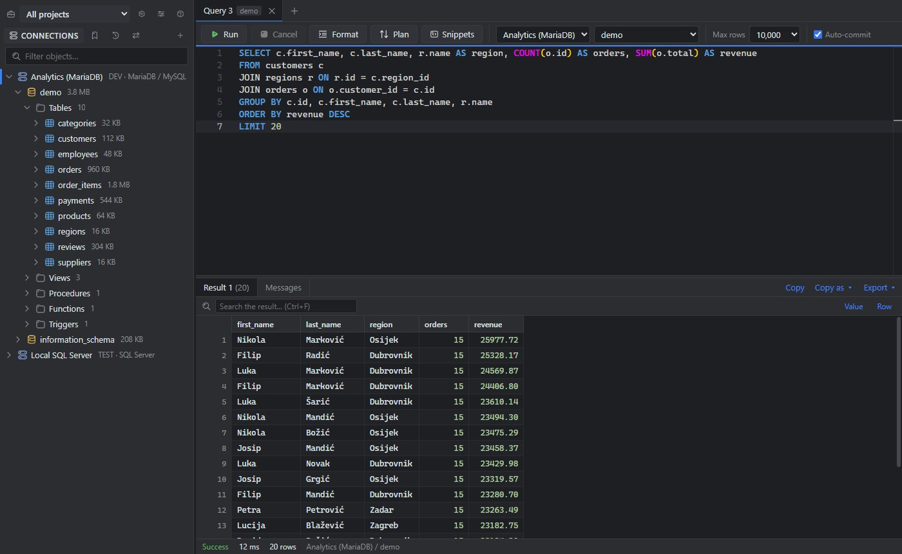

# QuCore

**The Power Behind Every Query.**

A lightweight desktop SQL editor for **SQL Server, PostgreSQL and MariaDB/MySQL**, with a built-in query manager:
projects, saved queries with versions, per-environment database aliases, variables, history with run trends, and
safety checks for production.
Electron + React + TypeScript. The database layer (`src/core`) has no Electron dependency.

The interface is in **English** and **Croatian** (Settings → Language). [Hrvatska verzija ovog dokumenta](README.hr.md).

**Website and downloads: [00dba00.github.io/qucore](https://00dba00.github.io/qucore/)**



## User guide

**[docs/guide/README.en.md](docs/guide/README.en.md)**: step by step, with screenshots ([Croatian](docs/guide/README.md)).
The same guide is built into the app (**F1**) and follows the interface language.

## Download and install

Installers for Windows, macOS (Intel and Apple Silicon) and Linux are attached to each GitHub release.

| Platform | File | Install |
|---|---|---|
| Windows 10/11 | `QuCore-Setup-x.y.z.exe` | run it and pick a folder |
| macOS 12+ | `QuCore-x.y.z-mac-arm64.dmg` (Apple Silicon) or `-mac-x64.dmg` (Intel) | open the .dmg and drag QuCore to Applications |
| Linux x64 | `QuCore-x.y.z-linux-x86_64.AppImage` or `.tar.gz` | `chmod +x QuCore-*.AppImage`, then run it |

### Installing unsigned builds

The builds are not code-signed yet, so the operating system warns the first time:

- **Windows** (SmartScreen, "Windows protected your PC"): click **More info** → **Run anyway**.
- **macOS** ("QuCore can't be opened because Apple cannot check it for malicious software"): in Finder right-click QuCore → **Open** → **Open**, or allow it in **System Settings → Privacy & Security → Open Anyway**. Only needed once.
- **Linux**: no warning. On distributions without FUSE 2, run the AppImage with `--appimage-extract-and-run` or use the `.tar.gz`.

Passwords are encrypted with Windows DPAPI, the macOS Keychain or the Linux secret service (GNOME Keyring / KWallet). On Linux without a keyring they can only be stored obfuscated, and the connection dialog warns about it.

## Building from source

Requires [Node.js 22+](https://nodejs.org).

```bash
npm install
npm run dev            # development with hot reload
npm run build:win      # Windows installer in dist/
npm run build:mac      # macOS .dmg and .zip (on a Mac)
npm run build:linux    # Linux AppImage and .tar.gz (on Linux)
```

Pushing a `vX.Y.Z` tag builds all three platforms in GitHub Actions (`.github/workflows/release.yml`) and attaches them to a draft release.

## Features

- **Connections**: SQL Server, PostgreSQL, MariaDB/MySQL; connection test; a color and an environment label (dev / test / prod) per connection.
  SQL Server sign-in: SQL Server login, Windows as the current user (`msnodesqlv8` + an ODBC driver for SQL Server; the newest
  installed one is picked: ODBC Driver 18 → 17 → Native Client 11 → the old `SQL Server` driver) or Windows domain\user + password (NTLM).
  Passwords are stored encrypted (Windows DPAPI through Electron `safeStorage`) in `%APPDATA%\QuCore\connections.json`.
- **Explorer**: databases → tables, views, procedures, functions, triggers → columns (PK, type, null, identity) and parameters,
  with sizes, lazy loading and a filter. A table tab shows columns, data, indexes, foreign keys and DDL.
  Generate SELECT / INSERT / UPDATE / DELETE templates for a table.
- **SQL editor** (Monaco, as in VS Code): multiple tabs, dialect syntax, autocomplete for tables and columns (understands aliases),
  formatting per dialect, find and replace. **Ctrl+Enter** runs the statement at the cursor, **F5** the whole editor.
  Tabs and their unsaved text come back after a restart. Open and save `.sql` files with their encoding kept.
- **Running queries**: several result sets, messages (PRINT / RAISE NOTICE / SHOW WARNINGS), affected rows, cancel (Esc),
  `GO` batches for SQL Server, `DELIMITER` for MariaDB; every tab has its own session (temporary tables and transactions survive between runs).
  Manual transactions with an Auto-commit switch, Commit and Rollback, and a question before anything would roll back silently.
- **Execution plans** (Ctrl+Shift+E) with the most expensive step marked, and ANALYZE for SELECT (PostgreSQL, MariaDB).
- **Results** stream in while the query runs and pause at *Max rows* (Load more / Count the rest / Close). A virtualized grid
  (smooth with 100,000 rows), quick search and per-column filters, full cell value panel (JSON / XML formatted, binary as hex),
  copy for Excel, copy as INSERT / JSON / Markdown / CSV, export to CSV / Excel / JSON.
- **Data editing** in the grid for tables with a primary key: the exact statements are shown before they run, everything runs in
  one transaction with parameters, and every statement must hit exactly one row.
- **ER diagram** from foreign keys (React Flow + ELK) with search, schema filter and SVG / PNG export.
- **Projects and saved queries**: a project groups databases and saved queries; folders, pinning, full-text search
  (FTS5 trigram, ignoring diacritics) with filters like `table:orders type:select ran:<7d is:broken`; every SQL change is a
  version with a diff and the duration / rows of the last 30 runs; a warning when a saved query uses a table that no longer exists.
- **Environments and aliases**: an alias (e.g. `core-db`) points to a database per environment; a query on an alias opens in
  the project's default environment, and each tab can switch.
- **Variables**: `:customer_id` or `${date_from}` open a form before running; values are escaped per dialect and remembered per project.
- **Data jobs**: move the result of a saved query (with its variables and environment) or a whole table into a table in
  another database (add, add or update by key, replace all; the table can be created) or into a CSV, JSON or Excel file.
  Rows stream in batches, a failed row is pinpointed, and every run is logged.
- **History**: every run with a fingerprint (literals as `?`), so the same query with other values counts as the same;
  after 5 runs in 7 days QuCore suggests saving it.
- **Safety**: confirmation before writes on production, an extra tick for `UPDATE` / `DELETE` without `WHERE` and `TRUNCATE`,
  a question when a saved query runs on another database, warnings when a query is suddenly much slower or empty.
  Each of these can be switched in Settings, with a note about the risk.

## Project structure

```
src/
  shared/types.ts        types + the StudioApi interface (the UI ↔ backend contract)
  shared/i18n.ts         t(), plural rules, number/date helpers; messages in shared/locales/en.ts (source) and hr.ts
  core/                  database work, no Electron
    manager.ts           ConnectionManager: connections and one session per tab
    drivers/mssql.ts     SQL Server (mssql/tedious; Windows sign-in through mssql/msnodesqlv8)
    drivers/postgres.ts  PostgreSQL (pg)
    drivers/mariadb.ts   MariaDB/MySQL (mysql2)
  main/                  Electron main process: IPC, encrypted connection storage, workspace (SQLite)
  preload/               exposes window.api (StudioApi) to the UI
  renderer/              React UI
docs/guide/              user guide (README.en.md, README.md) and screenshots
docker/                  test and demo databases (compose.yml, seed/)
scripts/                 tests, seeding, guide screenshots
```

`StudioApi` in `src/shared/types.ts` is the only contract between the UI and the backend, so a web version can implement it
over HTTP with the same `ConnectionManager`.

### Translations

English (`src/shared/locales/en.ts`) is the source catalog: it defines every key and its arguments, and `hr.ts` is typed against it,
so a missing translation fails `npm run typecheck`. Adding a language means a new catalog file and an entry in `LANGUAGES`
(`src/shared/i18n.ts`).

## Tests

```bash
npm run typecheck
npm run test:unit   # no databases: SQL parsing, fingerprints, search syntax, plans, exports, workspace store, translations
npm run db:up       # PostgreSQL 17, MariaDB 11.4 and SQL Server 2022 in Docker (ports 15432 / 13306 / 11433)
npm run test:db     # recreate the "shop" test database, then test:core and test:jobs on all three
npm run test:core   # tests only; other servers through PG_* / MARIA_* / MSSQL_* env variables, TEST_DBS=pg,maria picks some
npm run test:jobs   # data jobs: every source → destination pair, add or update, replace, failed row, cancel, files
npm run test:e2e
```

### Demo database and guide screenshots

```bash
npm run db:up && npm run db:demo          # "demo": a fictional web shop on the Docker MariaDB
npx electron-vite build
GUIDE_PROFILE=<empty folder> node scripts/guide-shots.mjs                 # Croatian screenshots
GUIDE_LANG=en GUIDE_PROFILE=<empty folder> node scripts/guide-shots.mjs   # English screenshots
```

The screenshots run on a temporary profile, never on your real one, and contain only fictional data.

### Website

```bash
npm run site:preview   # build site/dist and serve it at http://localhost:4173/qucore/
```

`site/src` holds the home page, layout, styles and script; `scripts/build-site.ts` adds the guide (one page per chapter) and the changelog. Pushing to `main` publishes it to GitHub Pages (`.github/workflows/pages.yml`).

## Known limitations

- SQL Server Windows sign-in (current user and NTLM) has not been tried against a real server yet; driver loading in the packaged app and the error for a missing server are verified. The old built-in `SQL Server` ODBC driver does not support *Trust the server certificate*, so with encryption it needs a valid certificate.
- Data editing has been tried by hand on MariaDB; PostgreSQL and SQL Server are covered by typecheck and SQL generation tests.
- Formatting: T-SQL procedure bodies with `BEGIN … END` come out correct but not pretty (a sql-formatter limitation).
- A paused query keeps its connection (and any locks) until it is loaded to the end, closed, or a new query runs in the tab.
- The ER diagram layout with one central table (e.g. `users` with dozens of references) comes out tall; tables can be moved with the mouse.
- *Close* on MariaDB cancels the query with `KILL QUERY`; until the kill arrives, the server keeps sending rows (they are discarded).
- Windows sign-in to SQL Server (current user, NTLM) works only on Windows; on macOS and Linux use a SQL Server login.
- The macOS build has not been tried on a Mac yet (it is built in CI); the Linux build was started and checked in a Debian container.

## License

[MIT](LICENSE)
