# QuCore user guide

*The Power Behind Every Query.* This guide explains everything QuCore does, step by step, as if you were opening it for the first time.
It applies to version **0.19**. The same guide is built into the app: press **F1** or click **?** next to the project picker. The screenshots use fictional demo data: the `demo` database is a small web shop (customers, products, orders, payments), and the project is called *Demo analytics*.

> **Maintenance rule:** every new feature is added to this guide (and to the Croatian `README.md`) in the same release.

## Contents

1. [What QuCore is](#1-what-qucore-is)
2. [First start](#2-first-start) (and the guide in the app)
3. [Connections](#3-connections)
4. [Explorer](#4-explorer)
5. [Editor and running queries](#5-editor-and-running-queries)
6. [Results](#6-results)
7. [Editing data in the grid](#7-editing-data-in-the-grid)
8. [ER diagram](#8-er-diagram)
9. [Query history](#9-query-history)
10. [Projects](#10-projects)
11. [Saved queries](#11-saved-queries)
12. [Search and filters](#12-search-and-filters)
13. [Versions and run trend](#13-versions-and-run-trend)
14. ["Save it?": the save suggestion](#14-save-it-the-save-suggestion)
15. [Environments and database aliases](#15-environments-and-database-aliases)
16. [Variables in queries](#16-variables-in-queries)
17. [Snippets](#17-snippets)
18. [Quick switcher (Ctrl+P)](#18-quick-switcher-ctrlp)
19. [Safety: production, queries without WHERE, wrong database](#19-safety-production-queries-without-where-wrong-database)
20. [Warnings after running](#20-warnings-after-running)
21. [Settings](#21-settings)
22. [Shortcuts](#22-shortcuts)
23. [Where your data is](#23-where-your-data-is)
24. [FAQ](#24-faq)

---

## 1. What QuCore is

QuCore is a desktop SQL editor for **SQL Server, PostgreSQL and MariaDB/MySQL**. In one window you get:

- a list of connections and a database explorer (tables, views, procedures…),
- a query editor with suggestions, formatting and multiple tabs,
- results that arrive while the query is still running,
- **projects** that hold the saved queries, history and databases of one piece of work (e.g. *AML*),
- protection against accidental changes on production.

The window has two parts: the **sidebar** on the left (project, Connections / Saved / History) and the **work area** on the right (query tabs).

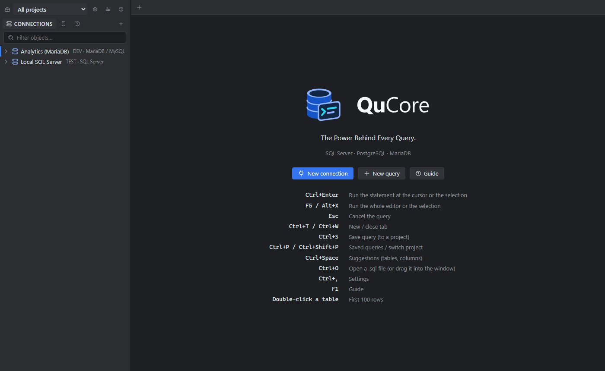

---

## 2. First start

1. Run the installer `QuCore Setup x.y.z.exe` and choose a folder (or keep the default). On macOS open the `.dmg` and drag QuCore to *Applications*; on Linux run the `.AppImage` (`chmod +x` the first time).
2. Open **QuCore**. You see the start screen with the **New connection** and **New query** buttons.
3. Click **New connection** and enter your database details (chapter 3).
4. When the connection appears on the left, click it: QuCore connects and shows the databases.

> **System warning on the first start:** the installer is not code-signed yet. Windows (SmartScreen): **More info** → **Run anyway**. macOS: in Finder right-click QuCore → **Open** → **Open** (only the first time).

> At the top of the sidebar is the project picker. Until you create a project it shows **All projects**, which means "no filter, everything is visible".

QuCore speaks English and Croatian; you can switch in [Settings](#interface-language).

### The guide in the app

This guide is built into QuCore and works offline:

1. Press **F1** (also while typing in the editor), click **?** next to the project picker, or **Guide** on the start screen.
2. A **Guide** tab opens: chapters on the left (the current one is highlighted), text with pictures on the right.
3. **Search the guide…** narrows the list to chapters that contain the text; **Enter** jumps to the first one.
4. Links in the text lead to chapters inside the tab. Close the tab like any other (**Ctrl+W**).

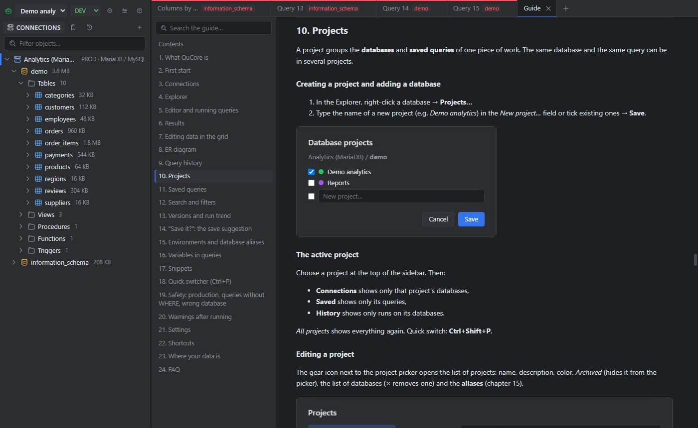

---

## 3. Connections

### New connection

1. Sidebar → **Connections** tab (server icon) → **+** at the top right (or the *New connection* button).
2. Choose the type: **SQL Server**, **PostgreSQL** or **MariaDB / MySQL**.
3. Enter a **Name** (how it appears in the list, e.g. *Production ERP*), the **Host** and the **Port** (the default port is filled in for you).
4. Enter the **User** and **Password** (or choose Windows sign-in, see below).
5. **Database** is optional: if you enter one, new queries open on it.
6. **Security**: for SQL Server *Encryption (TLS)* and *Trust the server certificate*; for the others *SSL*.
7. **Environment**: *dev*, *test*, *prod* or *no label*. The *prod* label turns on the safety checks (chapter 19).
8. **Color**: e.g. red for production; the color shows next to the connection and on its tabs.
9. Click **Test**. A green message with the server version means everything is fine. Then **Save**.

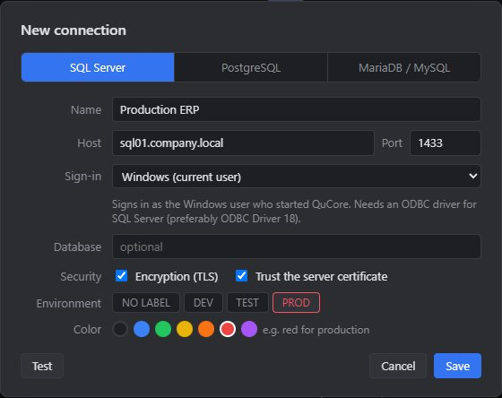

### SQL Server: sign-in options

| Sign-in | When to use it | What to enter |
|---|---|---|
| **SQL Server login** | a user and password defined on the server itself | user + password |
| **Windows (current user)** | your company uses Windows/domain accounts and you are signed in to the computer with yours | nothing: your Windows account is used |
| **Windows (domain\user)** | you need a different domain account | domain (or `COMPANY\john` in the User field) + password |

*Windows (current user)* needs an ODBC driver for SQL Server on the computer (preferably *ODBC Driver 18 for SQL Server*, free from Microsoft). QuCore picks the newest one installed.

### Editing and deleting

Right-click a connection → **Edit connection…**, **Refresh**, **Disconnect**, **Delete connection**.
Passwords are stored encrypted (Windows data protection, the macOS Keychain or the Linux secret service), never as readable text. Windows sign-in to SQL Server works only on Windows.

> **Linux without a keyring:** if the system has no GNOME Keyring or KWallet, the password can only be stored obfuscated (anyone who can read the profile folder can read it). The connection dialog then shows a yellow warning under the password. Install and unlock a keyring, then restart QuCore, or use a database account with limited rights.

---

## 4. Explorer

Clicking a connection opens it: you see the databases with their size, inside a database the folders **Tables, Views, Procedures, Functions, Triggers**, and inside a table its columns (key = primary key, type, *not null*, *identity*).

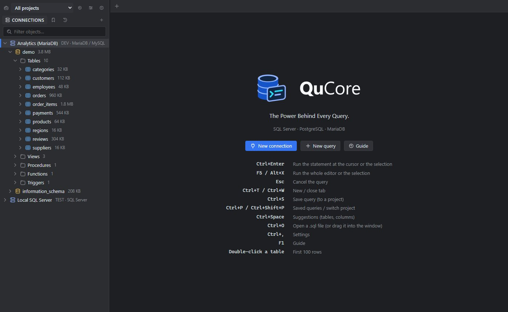

- **Filter objects…** (the field at the top) hides everything that does not contain the text.
- **Double-click a table** to open a new tab with its *first 100 rows*, run right away.
- **Double-click a column** to insert its name into the editor.
- **Right-click a table**: *Open table (structure and data)*, *SELECT first 100 rows*, *Row count*, *Generate SELECT / INSERT / UPDATE / DELETE* (see below), *Script (CREATE)*, *Insert name into editor*, *Copy name*.

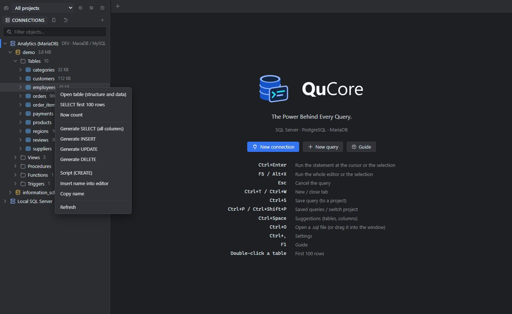

- **Right-click a database**: *New query*, *ER diagram*, *Projects…*, *Refresh*.

### Table tab: columns, data, indexes, foreign keys, DDL

Right-click a table (or view) → **Open table (structure and data)** opens a tab with everything about that table in one place:

| Tab | What it shows |
|---|---|
| **Columns** | name, type, *NOT NULL*, default value, primary key and *identity* |
| **Data** | the first 100 rows, with the same editor and grid as a normal tab (editing, filters, export, transactions); the query runs only when you open this tab |
| **Indexes** | every index with its columns in order, *PK* / *UNIQUE*, kind (BTREE, CLUSTERED…) and INCLUDE columns (SQL Server) |
| **Foreign keys** | *This table references* and *Referenced by*; clicking the other table's name opens its tab |
| **DDL** | the `CREATE` script (*Copy* or *Open in a new tab*) |

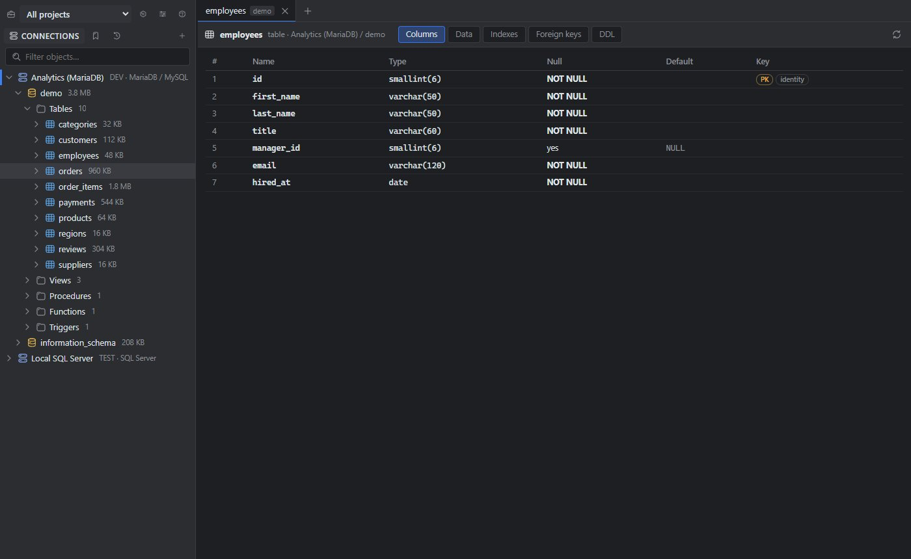

- The same table never opens twice: *Open table* again just activates its tab.
- **Refresh structure** (icon on the right) reloads the structure after an `ALTER TABLE`.
- Double-clicking a table still opens a normal tab with the first 100 rows.
- Views have the Columns, Data and DDL tabs.

### Generating SQL for a table

Right-click a table → **Generate …** opens a new tab with a ready template (nothing is run):

| Item | What you get |
|---|---|
| *Generate SELECT (all columns)* | `SELECT` with every column listed by name (instead of `*`), first 100 rows, so it is easy to remove the columns you do not need. Works for views too. |
| *Generate INSERT* | all columns except *identity* / *auto_increment* (the database fills those); each value has a comment with the type, *not null* and default value |
| *Generate UPDATE* | `SET` for all columns except the key, `WHERE` on the primary key |
| *Generate DELETE* | `WHERE` on the primary key |

The values are **variables** (`:name`, see [Variables in queries](#16-variables-in-queries)): when you run the template, QuCore opens a dialog where you enter the values. Example for table `orders` with key `id`:

```sql
UPDATE orders
SET
    status = :status,
    total = :total
WHERE id = :id;
```

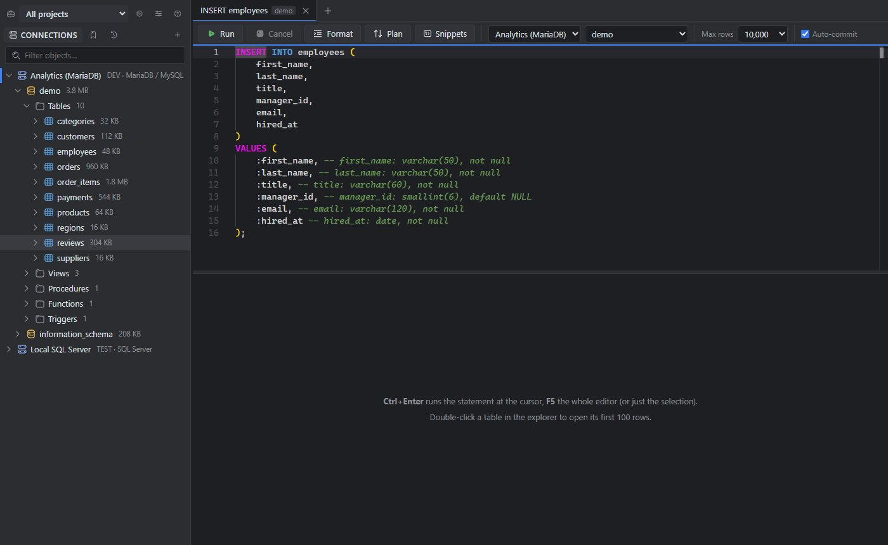

> If the table **has no primary key**, UPDATE and DELETE get `WHERE 1 = 0` with a comment: such a statement changes nothing until you write a real condition. The UPDATE/DELETE-without-WHERE check (chapter 19) and the production confirmation apply to generated statements too.

---

## 5. Editor and running queries

### Opening a tab

- **Ctrl+T** or **+** next to the tabs: a new query on the same connection as the active tab.
- Double-click a database in the Explorer: a new query on that database.
- In the tab's toolbar you choose the **connection** and the **database** (drop-downs).

**Tabs are remembered.** When you close QuCore and open it again, all open tabs come back with the text you typed (even unsaved), the cursor position, the connection and the database. The queries are **not run** and the results do not come back; press **F5** or **Ctrl+Enter** when you need them. An ER diagram loads only when you open its tab. If a connection was deleted in the meantime, the tab is left without a connection: pick a new one in the toolbar.

### .sql files on disk

Open and save a script you got as a file (or need to send to someone) directly:

1. **Ctrl+O** (or drag one or more `.sql` / `.txt` files into the QuCore window). Each file opens in its own tab, titled with the file name, on the active tab's connection.
2. Edit the text: a **●** appears next to the tab name (unsaved changes).
3. **Ctrl+S** saves back to the same file and the ● goes away.
4. Right-click the tab → **Save to file as…** saves to a new file (works for a normal tab too, which then becomes that file's tab).

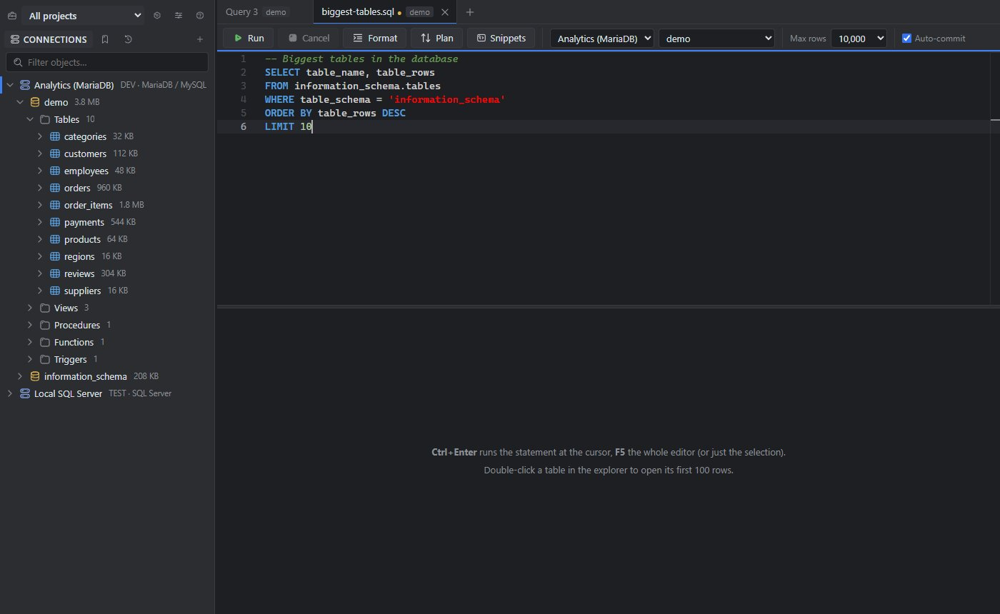

Good to know:

- **The encoding is kept.** QuCore recognizes UTF-8 (with and without BOM), UTF-16 (SSMS uses it when saving as "Unicode") and the old Windows-1250, and saves in the same one. A message tells you when a file is not plain UTF-8. If you type a character that Windows-1250 does not have (e.g. an emoji), the file is saved as UTF-8 with BOM and the message says so.
- **Closing a tab with ●** asks: *Save*, *Don't save* or *Cancel*. *Close others* does not close files with unsaved changes.
- The same file never opens twice: Ctrl+O on an open file just activates it.
- In a file tab **Ctrl+S saves to the file**, not to saved queries. To add it to a project, use **Ctrl+Shift+S** (save as a new query).
- Files larger than 20 MB are not opened (the editor is not suited for them).
- With [restored tabs](#21-settings) on, a file tab comes back after a restart too, with its unsaved changes and the ● mark.
- QuCore reads and saves only files you chose yourself (see [Where your data is](#23-where-your-data-is)).

### Running

1. Type some SQL, e.g.:
   ```sql
   SELECT table_name, table_rows
   FROM information_schema.tables
   ORDER BY table_rows DESC
   LIMIT 20
   ```
2. Press **Ctrl+Enter**: only the **statement at the cursor** runs (it flashes briefly in the editor).
3. **F5**, **Alt+X** or the *Run* button run the **whole editor**.
4. If you **select** part of the text, only the selection runs (with both Ctrl+Enter and F5).
5. **Esc** or *Cancel* stops the query; rows that already arrived stay in the grid.

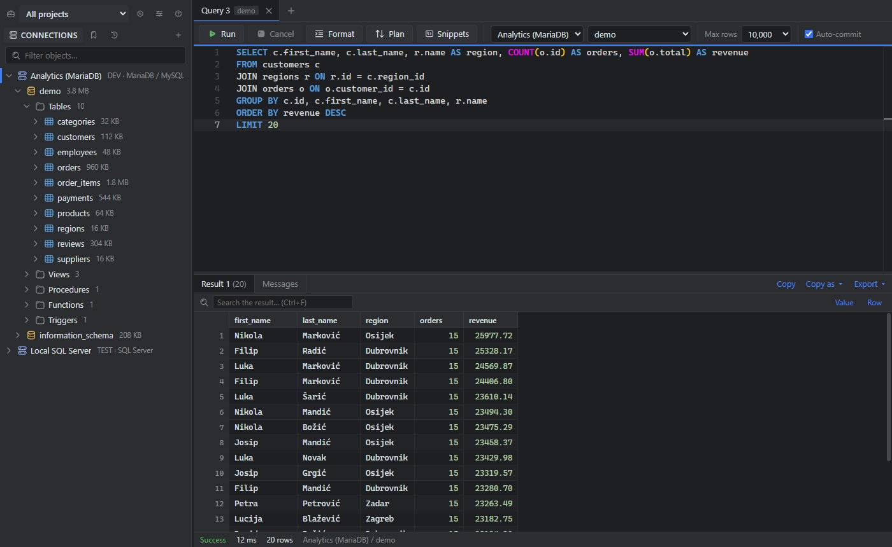

How QuCore finds where a statement starts and ends (for **Ctrl+Enter**):

- statements are separated by **`;`** or a **blank line**, and on SQL Server also by **`GO`**;
- a `;` inside a string, a comment or a `BEGIN … END` / `CASE … END` block does not separate;
- SQL Server `CREATE/ALTER PROCEDURE`, `FUNCTION`, `TRIGGER` and `VIEW` run up to the next `GO`, and a MariaDB `DELIMITER $$ … DELIMITER ;` block runs as a whole;
- if the cursor is on a blank line between two statements separated by blank lines, nothing runs: move the cursor onto a statement.

Example: with the cursor on the second line, **Ctrl+Enter** runs only `SELECT COUNT(*) FROM orders;`:

```sql
SELECT * FROM customers WHERE id = 7;
SELECT COUNT(*) FROM orders;

UPDATE orders SET status = 'x' WHERE id = 1
```

Good to know:

- Several statements at once work (each gives its own *Result* tab). SQL Server understands `GO`, MariaDB `DELIMITER`.
- Every tab has **its own session**: temporary tables and transactions stay between runs in the same tab.
- **Max rows** (toolbar) limits how many rows are shown per result.

### Transactions: Auto-commit, Commit, Rollback

**Auto-commit** is on by default: every statement is saved to the database permanently right away. For sensitive changes (e.g. a manual `UPDATE` on production), turn it off, check the changes first and only then save them.

1. In the tab's toolbar, untick **Auto-commit**.
2. Run a query (e.g. `UPDATE orders SET status = 'x' WHERE id = 1`). The first query opens a transaction, and the toolbar shows a **Transaction · 1 run · 0:05** badge with **Commit** and **Rollback** buttons.
3. Check the result (e.g. `SELECT * FROM orders WHERE id = 1`): this tab sees the change, but other users and other tabs **do not** until you Commit.
4. **Commit** saves every change in the transaction permanently. **Rollback** undoes them all.
5. The next query opens a new transaction (while Auto-commit is off).

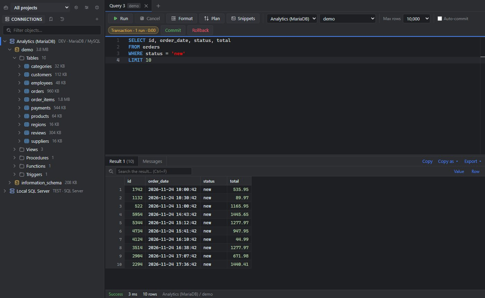

More to know:

- **The badge counts runs and the time** since the transaction opened. After 5 minutes it becomes more prominent: an open transaction keeps rows locked and other queries wait for them, so do not leave it open longer than needed.
- With Auto-commit off, even a plain `SELECT` opens a transaction.
- **The red "Transaction in error" badge** (PostgreSQL, and SQL Server with `SET XACT_ABORT ON`): a statement failed and the database accepts no more changes in that transaction; only **Rollback** is possible.
- QuCore also recognizes a transaction you open yourself (`BEGIN`, `BEGIN TRAN`, `START TRANSACTION`) with Auto-commit on. If you close it in a query (`COMMIT` / `ROLLBACK`), the badge disappears and *Messages* says the transaction is no longer open; the same happens when a statement commits by itself (on MariaDB e.g. `CREATE` / `ALTER` / `DROP`) or the connection drops.
- **Closing the tab or the app, disconnecting or deleting the connection** with an open transaction asks you to decide: *Commit and close*, *Rollback and close* or *Cancel*. Changing the connection or database in the toolbar asks for confirmation and rolls back.
- **Commit is not possible while a result waits for the remaining rows** (*Max rows*): first *Load more* to the end or close it. On PostgreSQL closing such a result cancels the query, which breaks the whole transaction (you get the red badge).
- **Saving changes from the grid** (chapter 7) uses a separate connection, so it is blocked while a transaction is open: Commit or Rollback first, then save.
- The Auto-commit tick is remembered per tab (also after a restart); an open transaction is not: closing the app always ends it.
- How new tabs start (with or without Auto-commit, separately for production) is set in [Settings](#21-settings).

### Execution plan (why a query is slow)

The plan shows **how** the database runs a query: which tables it reads in full, which through an index, how it joins and sorts them.

1. Put the cursor on a statement (or select it) and press **Ctrl+Shift+E** or the **Plan** button in the toolbar.
2. A **Plan** tab opens at the bottom: a tree of operations with details (table, index, condition, access method), the **estimated cost** and the **estimated row count**. The query is **not run**.
3. The step with the highest own cost is marked red as **most expensive**: that is usually where an index or a different condition is needed.
4. **Run with ANALYZE** (PostgreSQL and MariaDB) really runs the query and adds the **actual rows** and **time in ms** per step; *most expensive* then means the most own time. When the actual row count differs from the estimate 10 times or more, the number is yellow: the database misjudged it (often outdated statistics).

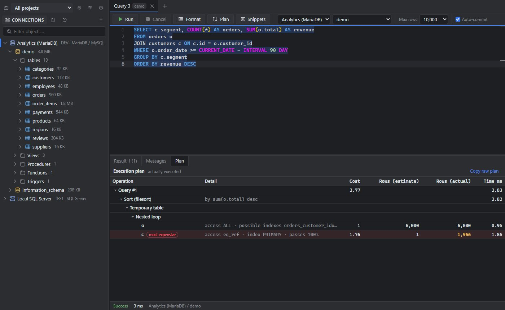

Good to know:

- A plan is made for **one statement**. For a query with variables (`:x`), run it first or replace the variables with values.
- **ANALYZE is allowed only for SELECT**, because it really runs the statement (UPDATE / DELETE would change data). For other statements use the plan without ANALYZE: it changes nothing.
- SQL Server shows the **estimated** plan (no ANALYZE).
- **Copy raw plan** copies the plan as the database returned it (JSON or XML), for sharing or external plan analysis tools.
- The plan runs on the tab's session (same database, temporary tables, open transaction).

### Suggestions (autocomplete)

Type and press **Ctrl+Space**: tables, columns and keywords are offered. Aliases are understood: after `FROM orders o`, typing `o.` offers the columns of *orders*.

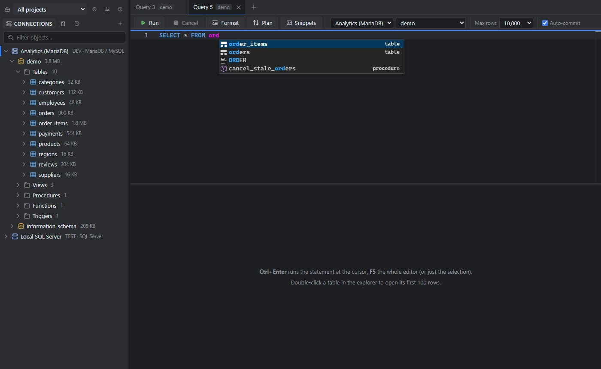

### Formatting

**Format** (or **Shift+Alt+F**) tidies the SQL according to the dialect; if something is selected, only that is formatted.

### Find and replace in the editor

1. In the editor press **Ctrl+F** and type: every match is highlighted, and the right side shows which one is current and how many there are (e.g. *2 of 4*).
2. **Enter** or **F3** goes to the next match, **Shift+Enter** / **Shift+F3** to the previous one. **Esc** closes the bar.
3. **Ctrl+H** also opens the replace field: type the new text, then **Enter** (replace the current one) or **Ctrl+Alt+Enter** (replace all). Ctrl+Z undoes a replace.
4. Buttons in the bar: **Aa** matches case, **ab** whole words, **.*** regular expressions.

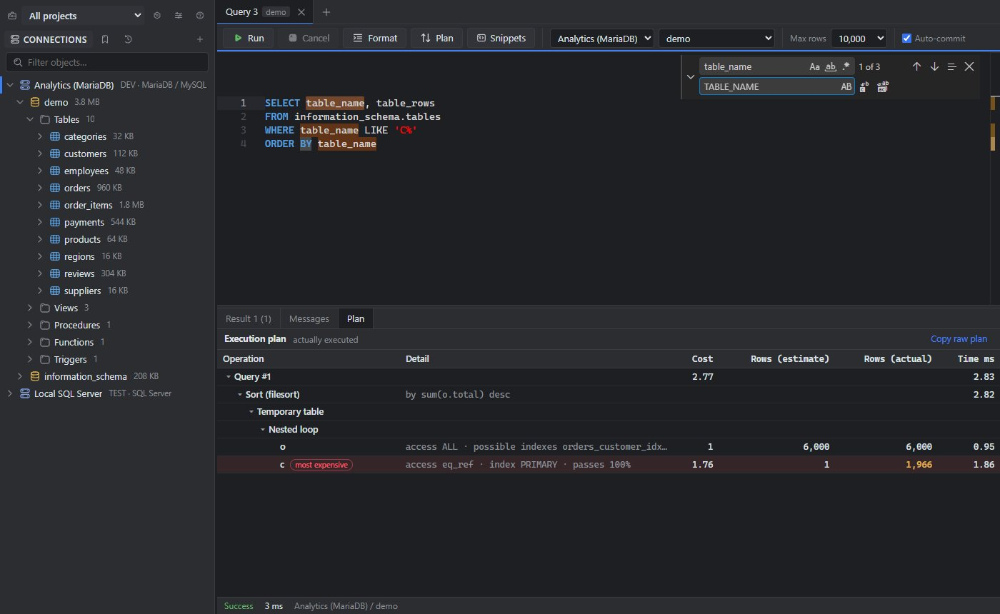

Good to know:

- **Ctrl+D** selects the word at the cursor, and every further Ctrl+D adds the next occurrence with its own cursor: typing changes them all at once (a quick way to rename a column in a query).
- In the **result grid** Ctrl+F searches the result (chapter 6); in the editor it searches the query text.

---

## 6. Results

- The grid stays fast with 100,000 rows. Click a header to sort; drag a column edge to change its width.
- **Copy**, **Copy as ▾** and **Export ▾** in the bar above the grid copy or save the result; see below.
- The **Messages** tab: PRINT output, warnings, affected row counts, errors with the line number.

### Filtering results

Above the grid is the **Search the result…** field. Filtering works on the rows already loaded, without running the query again.

**Quick search**

1. Click into the field (or press **Ctrl+F** while the grid has focus) and type.
2. Only rows where **some** column contains the text stay (case does not matter); matches are highlighted in yellow.
3. **Enter** or **↓** returns focus to the grid, **Esc** clears the search.

**Column filter**: right-click a cell:

| Item | Keeps the rows where that column is… |
|---|---|
| *Filter: = value* | exactly that value |
| *Filter: ≠ value* | anything else, **including NULL** |
| *Filter: IS NULL* / *IS NOT NULL* | NULL / any value |

Each filter shows as a **chip** next to the field (e.g. `status = paid`); **×** removes it. Filters on different columns apply together (both must match); a new filter on the same column replaces the old one. Next to the chips you see how many rows are shown, e.g. **13 of 300**, and **Remove filters** brings them all back.

Example: the last 300 orders, right-click `paid` in the *status* column → *Filter: = paid*, then type `mobile` in the field → only paid orders from the mobile app remain.

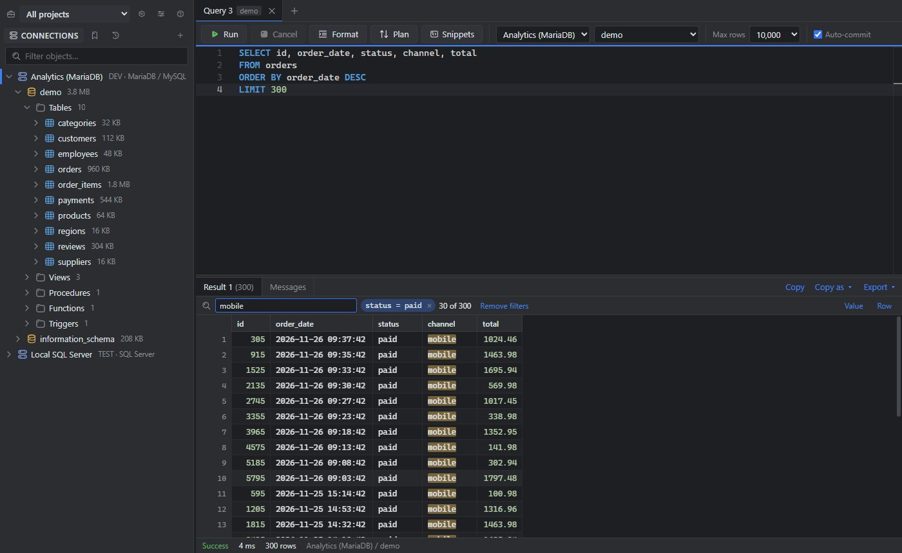

Good to know:

- Sorting, all copying and **Export** work on the **displayed** (filtered) rows, and the file contains only those.
- Filters use the values as they came from the database; unsaved changes (data editing) do not affect them, and new rows are always visible.
- Running the query again clears the filters. If the query is paused at *Max rows*, a filter sees only the loaded rows; **Load more** adds more.

### Copying results (with column names)

Fastest: click **Copy** in the bar above the grid. The clipboard gets **the column names in the first line and every displayed row**, exactly in the order you see them (also after sorting). The button briefly shows *Copied: N rows ✓*.

Then click a cell in Excel or Google Sheets and press **Ctrl+V**: every column goes into its own column (values are tab-separated).

Right-clicking a cell offers other ways:

| Item | What it copies |
|---|---|
| *Copy cell* (**Ctrl+C**) | just that value |
| *Copy row* | the whole row, without column names |
| *Copy row with column names* | column names + that row |
| *Copy all with column names* (**Ctrl+A** in the grid) | the same as the *Copy* button |
| *Copy all without column names* | rows only |
| *Copy as IN (…) list* | the column's values as `('a', 'b', …)` for SQL |
| *Copy row as INSERT* | an `INSERT` statement for that row |
| *Copy all as INSERT* | `INSERT` statements for all displayed rows |

> What is copied is what has been loaded into the grid. If the query is paused at *Max rows*, first **Load more** or raise *Max rows*.

### Full cell value and the row vertically

A cell in the grid shows only the start of a long text. For the whole value:

1. Select the cell (click or arrow keys) and press **Shift+Enter**, or click **Value** on the right of the bar above the grid.
2. A panel with the full value opens on the right:
   - **JSON** and **XML** are formatted (indented and colored), with collapsible parts;
   - **long text** wraps into lines and shows how many characters it has;
   - **binary data** is shown as hex with an ASCII column and the size in bytes;
   - **Copy** copies the original value.
3. Arrow keys in the grid change the cell, and the panel follows. **Shift+Enter** or **×** closes the panel.

**Row** (a button in the bar or in the panel) shows the selected row vertically, *column — value*: handy for tables with many columns that do not fit on screen. Up/down arrows in the grid change the row; clicking a column in this view opens its full value.

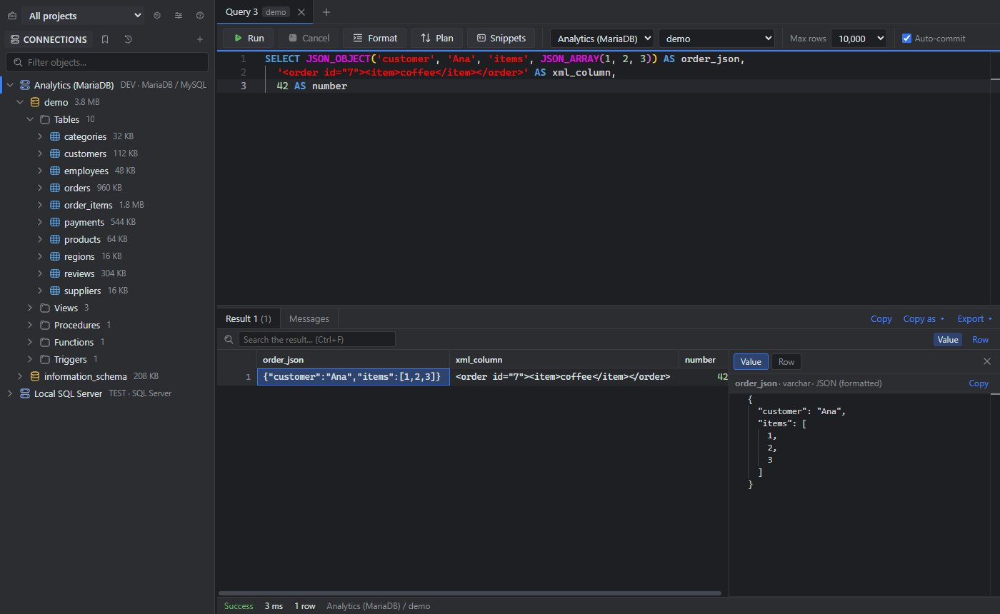

> The panel stays open for the next run. Values are read-only here; you edit them in the grid (chapter 7). Very long binary data arrives truncated, so the panel shows its start and says so.

### Copy as: INSERT, JSON, Markdown, CSV

**Copy as ▾** in the bar above the grid copies all displayed rows in another format:

| Format | For |
|---|---|
| **INSERT statements** | moving rows to another database or script: one `INSERT` per row, with quotes and `NULL` by the database's rules (SQL Server `N'…'`, binary data as `0x…`) |
| **JSON** | an array of objects (`[{"id": 1, "name": "…"}, …]`); numbers stay numbers, NULL is `null` |
| **Markdown table** | for Jira, Confluence, GitHub or a README; numbers aligned right |
| **CSV** | separated with `;` |

The table name in INSERT statements: if the tab was opened from the Explorer (double-click a table), that table is used; otherwise the table from the query if it has **only one**. If the table is unknown (a JOIN of several tables), `table_name` is written and a note appears: replace it.

Example: `SELECT id, name FROM customers WHERE id < 3` → *Copy as ▾ → INSERT statements*:

```sql
INSERT INTO customers (id, name) VALUES (1, 'Ana');
INSERT INTO customers (id, name) VALUES (2, 'O''Brien');
```

### Export to a file: CSV, Excel, JSON

**Export ▾** saves the displayed rows to a file (QuCore asks where; the name is the tab title):

- **CSV (.csv)**: `;` as the separator; Excel opens it correctly, including accented letters.
- **Excel (.xlsx)**: a real Excel file: numbers are numbers (you can sum them), dates are dates, the header is bold and frozen, and a filter is on. Numbers with more than 15 digits stay text, because Excel would round them.
- **JSON (.json)**: the same as *Copy as → JSON*.

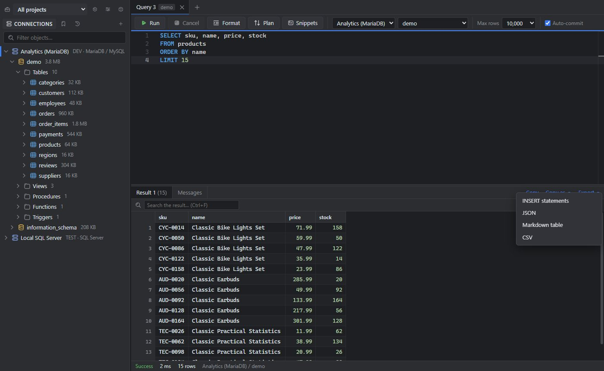

### Results arrive in parts (streaming)

The first rows show up right away, while the query is still running. When *Max rows* is reached, the query is **paused** (it stays open on the server) and a bar appears at the bottom:

- **Load N more** fetches the next page,
- **Count the rest** reads the rest only to tell you the exact row count,
- **Close** cancels the query on the server.

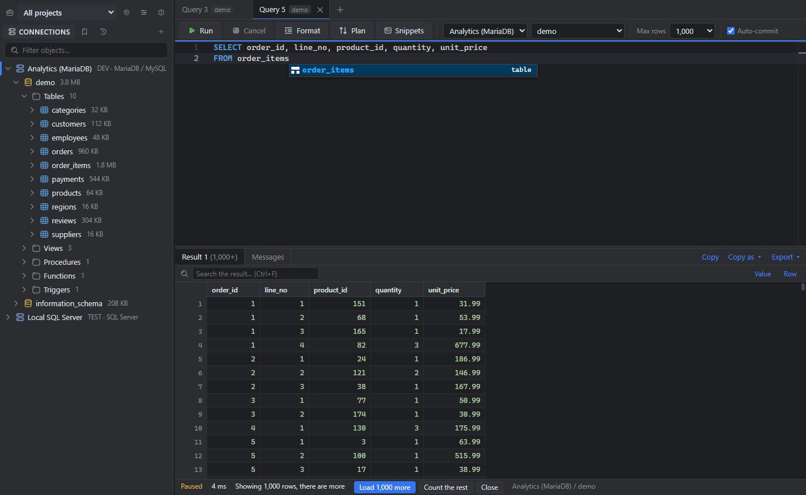

---

## 7. Editing data in the grid

Works for a table opened from the Explorer (double-click or *SELECT first 100 rows*) that has a **primary key**.

1. Double-click (or **F2**) a cell → type the new value → **Enter**.
2. Right-click a cell: *Set NULL*, *Delete row*; at the top **+ New row**.
3. Changed cells are highlighted; the bar shows the number of changes.
4. **Save…** shows the **exact SQL statements** that will run. Only clicking *Run and save* in that window runs them.
5. Everything runs in **one transaction**: every statement must hit exactly one row, otherwise nothing is saved.

On a production connection the preview also shows a red **PROD** badge. *Discard* undoes all unsaved changes.

---

## 8. ER diagram

Right-click a database → **ER diagram**. A tab opens with the tables (columns, key, foreign key) and the relationships between them.

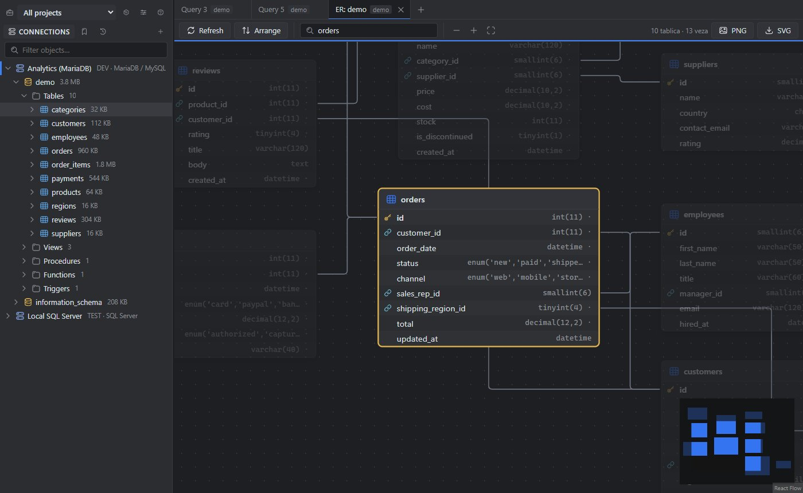

- **Search** highlights tables and columns; **Enter** jumps to the first one.
- Clicking a table highlights its relationships.
- Buttons: refresh, arrange again, schema filter, zoom, fit to screen, minimap.
- **Export**: SVG or PNG of the whole diagram (not just the visible part).

---

## 9. Query history

Sidebar → **History** tab (clock icon). Every run is recorded: connection, database, time, duration, row count, error or *cancelled*.

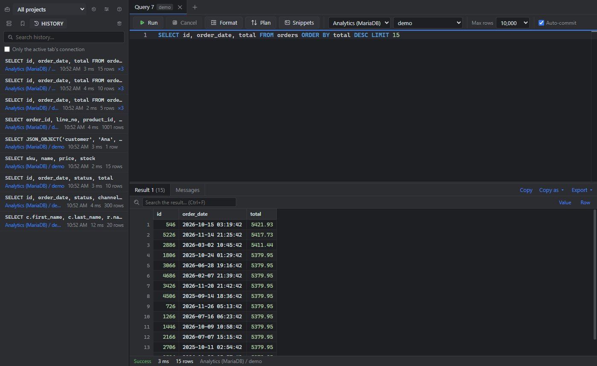

- **×N** means the same query was run N times, even with different values (`WHERE id = 5` and `WHERE id = 7` are the same query).
- **Double-click** opens the query in a new tab (with the variable values used at the time).
- *Only the active tab's connection* narrows the list; the active project filters it too.
- Right-click: insert into the editor, copy, delete. The bin at the top deletes the whole history.

---

## 10. Projects

A project groups the **databases** and **saved queries** of one piece of work. The same database and the same query can be in several projects.

### Creating a project and adding a database

1. In the Explorer, right-click a database → **Projects…**
2. Type the name of a new project (e.g. *Demo analytics*) in the *New project…* field or tick existing ones → **Save**.

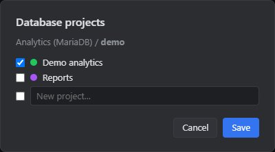

### The active project

Choose a project at the top of the sidebar. Then:

- **Connections** shows only that project's databases,
- **Saved** shows only its queries,
- **History** shows only runs on its databases.

*All projects* shows everything again. Quick switch: **Ctrl+Shift+P**.

### Editing a project

The gear icon next to the project picker opens the list of projects: name, description, color, *Archived* (hides it from the picker), the list of databases (× removes one) and the **aliases** (chapter 15).

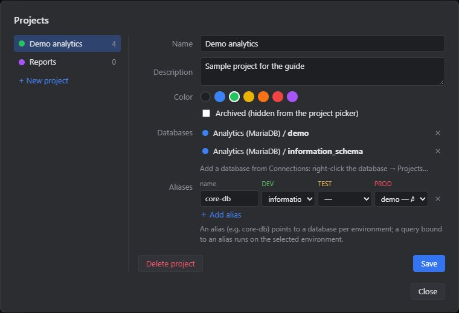

---

## 11. Saved queries

### Saving

1. Write a query in a tab and press **Ctrl+S**.
2. Enter a **Title**, optionally a **Description** (a ticket number works too, e.g. `DEMO-101`), a **Folder** (e.g. `Reports/Monthly`) and tick the **Projects**.
   QuCore suggests the project the database belongs to.
3. **Save**. The tab takes the query's title.
4. Every further **Ctrl+S** in that tab saves changes right away, without asking. **Ctrl+Shift+S** saves as a new query.

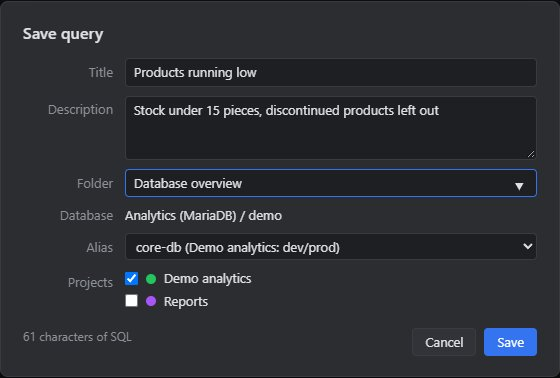

### The Saved panel

Sidebar → **Saved** tab (bookmark icon).

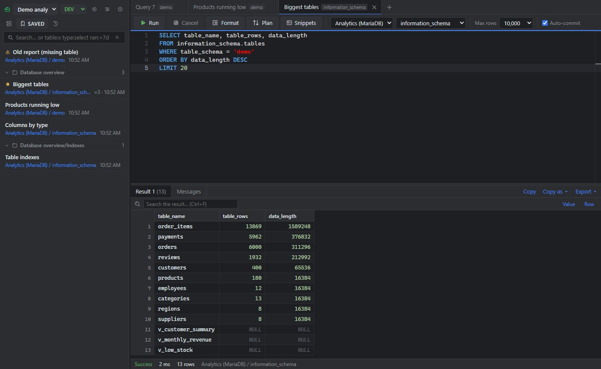

- **Recently run**: up to 5 queries run in the last 2 weeks.
- **Folders** collapse with a click (QuCore remembers which are closed).
- ★ = pinned to the top; **×N · time** = how many times it ran and when last.
- ⚠ = the query uses a table that no longer exists (see below).
- **Double-click** opens the query (if it is already open, QuCore just switches to its tab).
- Right-click: insert into the editor, copy SQL, pin, *Title, description, folder and projects…*, *Versions and runs…*, delete.
- Hovering over a query shows its description, the tables it uses, the statement kind and the SQL.

### Warning: the table no longer exists

When you open a database in the Explorer, QuCore checks that database's saved queries. If a query uses a missing table, it gets a **⚠** with a message saying which table is missing and where it was checked. Find all of them with the `is:broken` filter.

---

## 12. Search and filters

In the field at the top of the **Saved** panel you can type text (searched in the title, description and SQL, ignoring diacritics such as č/ć/š/ž) and **filters**. The **?** button shows the list; clicking an example inserts it.

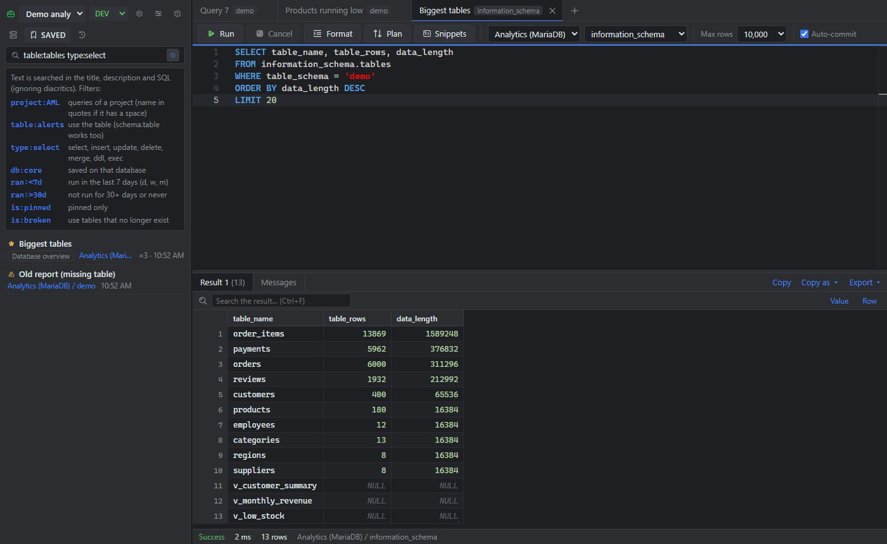

| Filter | Meaning | Example |
|---|---|---|
| `project:` | queries of a project | `project:"Demo analytics"` |
| `table:` | use the table | `table:alerts`, `table:dbo.orders` |
| `type:` | statement kind | `type:select`, `type:delete` |
| `db:` | saved on the database | `db:core` |
| `ran:<7d` | run in the last 7 days (`d`, `w`, `m`) | `ran:<2w` |
| `ran:>30d` | not run for 30+ days (or never) | `ran:>1m` |
| `is:pinned` | pinned only | |
| `is:broken` | use tables that no longer exist | |

Example: `refund table:payments type:select ran:<7d` = queries that contain "refund" in their text, read the *payments* table and were run this week. A mistyped filter shows a yellow message under the field.

---

## 13. Versions and run trend

Every save with **changed SQL** is a new version (changing the title or projects is not).

Right-click a saved query → **Versions and runs…**

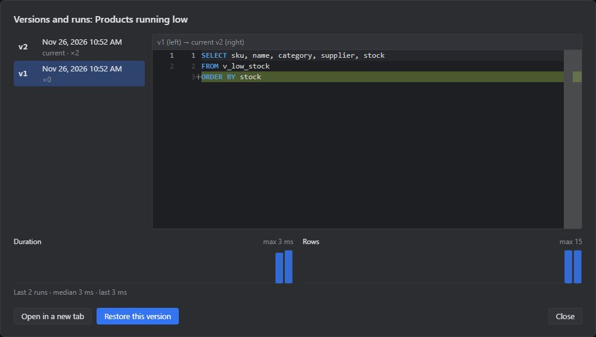

- On the left, the list of versions (v1, v2…, date, how many times it ran).
- On the right, a **comparison**: the selected version on the left, the current one on the right; red = removed, green = added.
- **Restore this version** saves it as a new (latest) version; if the query is open in a tab, the text is replaced (**Ctrl+Z** undoes it).
- **Open in a new tab** just shows or runs the old version.
- At the bottom, **Duration** and **Rows** of the last 30 runs (newest on the right). Hovering over a bar shows the date, duration, rows and version. Grey bars are errors or cancellations.

---

## 14. "Save it?": the save suggestion

QuCore recognizes the same query even with different values. When you run the same query **5 times in 7 days**, a bar appears above the result:

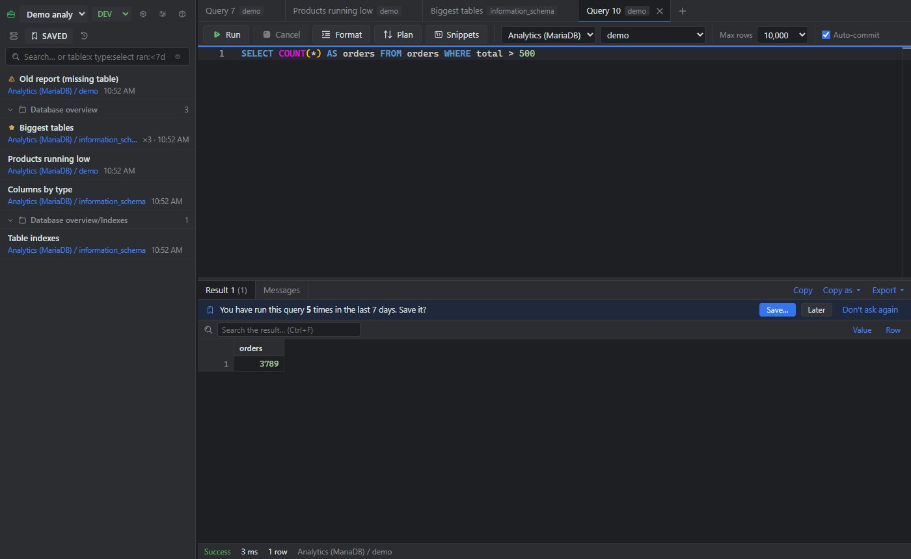

- **Save…** opens the save dialog,
- **Later** stops asking in this tab,
- **Don't ask again** never asks for that query.

---

## 15. Environments and database aliases

The same query often has to run on the **dev**, **test** and **prod** database. Instead of three copies, use an **alias**.

### Setting up

1. Set the **Environment** (dev / test / prod) of your connections in the connection dialog.
2. Add the databases to a project (chapter 10).
3. Gear next to the project → **Aliases** → **+ Add alias** → a name (e.g. `core-db`) and a database for each environment.
4. **DEV / TEST / PROD** appears next to the project picker: the default environment in which queries on an alias open.

### A query on an alias

When saving (Ctrl+S), choose an **Alias** (QuCore suggests one if the tab's database is part of an alias). Such a tab shows the alias and an **environment picker** in its toolbar:

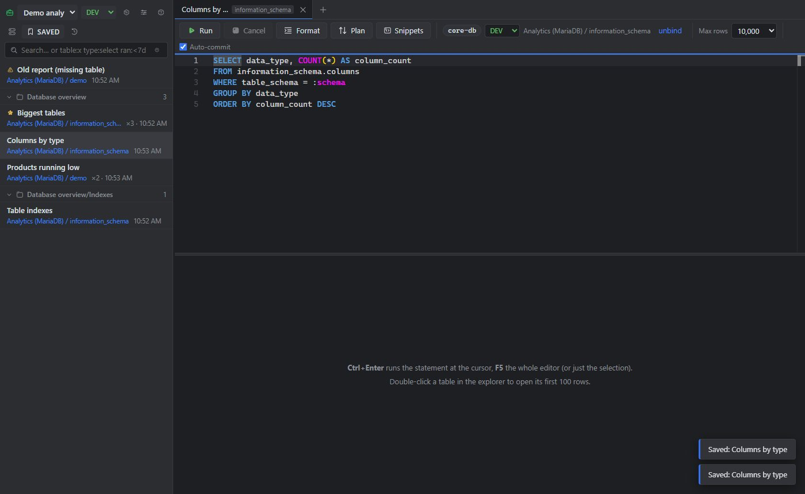

- Changing the environment in the tab switches it to the matching database: you can have the same query open on test and on prod.
- Changing the project's default environment **does not touch** open tabs.
- **unbind**: the tab stays on its current database, without the alias.

---

## 16. Variables in queries

Write `:name` or `${name}` instead of a value:

```sql
SELECT data_type, COUNT(*) AS column_count
FROM information_schema.columns
WHERE table_schema = :schema
GROUP BY data_type
```

On **F5** a form opens:

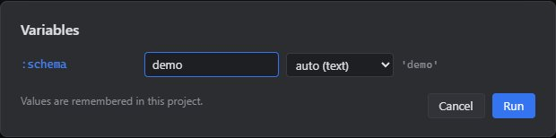

- Enter a value; the **type** is *auto* by default (a number if it looks like one, otherwise text). You can also choose *text*, *number*, *NULL* or *SQL expression* (e.g. `CURRENT_DATE - 7`).
- On the right you see **exactly what goes into the SQL** (with correct quotes). An invalid number does not let the query run.
- Values are **remembered per project**; a run opened from history offers the values used at the time.
- `:name` inside quotes or comments, `::cast` (PostgreSQL), `:=` and `@variables` (SQL Server) are **not** variables.

---

## 17. Snippets

A snippet is a saved piece of SQL (e.g. `WHERE created_at >= CURRENT_DATE - INTERVAL 7 DAY`).

- **Snippets** button in the toolbar → click a snippet to insert it at the cursor.
- Select text → **Snippets** → **Save selection as snippet…** → name → *Applies to* (a project or all projects).
- **Edit snippets…**: change, delete.

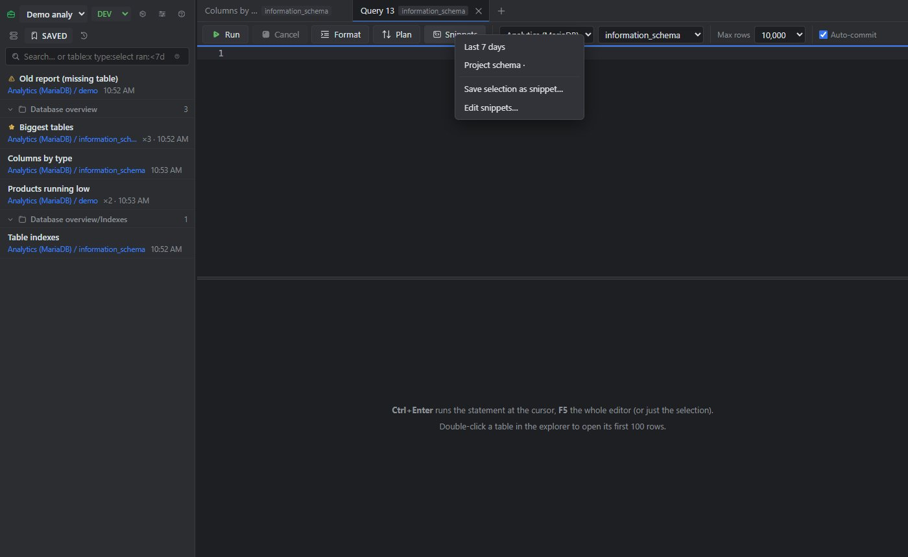

---

## 18. Quick switcher (Ctrl+P)

- **Ctrl+P** searches saved queries (of the active project) and projects; the first letters are enough. **Enter** opens.
- **Ctrl+Shift+P** switches the project only.

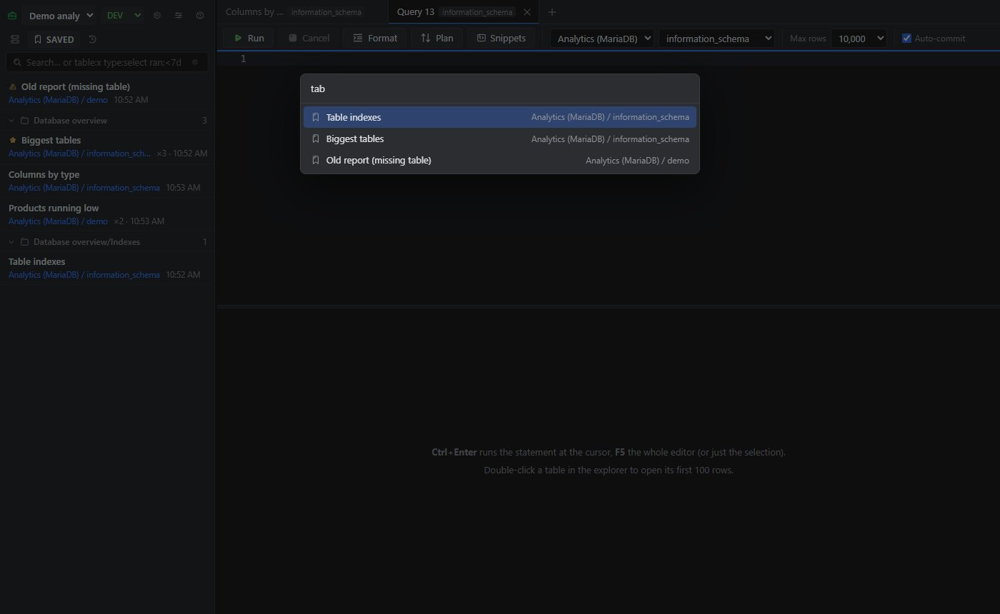

---

## 19. Safety: production, queries without WHERE, wrong database

All three checks are on by default; you can turn each one off in [Settings](#21-settings), which also explains the risk.

### Production

A tab on a connection marked **prod** has a red frame and a **PROD** badge (also in the tab bar). Before `INSERT`, `UPDATE`, `DELETE`, `MERGE`, `CREATE/ALTER/DROP/TRUNCATE` or `EXEC` it asks for confirmation. `SELECT` runs without asking.

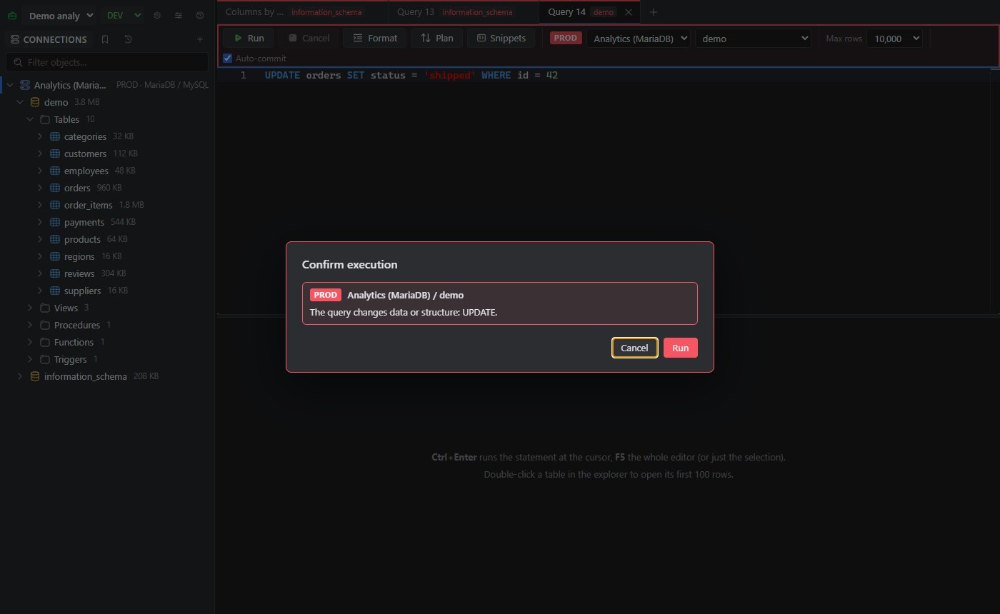

### UPDATE / DELETE without WHERE, TRUNCATE

On **any** connection, a statement that changes **every row** needs an extra tick, **I understand it changes every row**; without it *Run* does nothing. A `WHERE` in a subquery does not count.

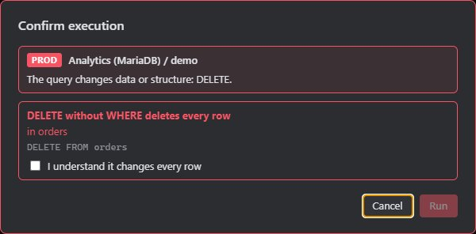

The focus is always on **Cancel**, so an accidental Enter runs nothing.

### Wrong database

If you run a saved query on a different database than it was saved for, QuCore asks whether you are sure (*Do not ask again in this tab* turns the question off for that tab).

---

## 20. Warnings after running

QuCore compares a run with earlier runs of **the same query on the same database** and shows a yellow bar when the run is:

- **slow**: more than 5× longer than usual (and longer than 1 second),
- **empty**: it returned 0 rows, but it usually returns rows.

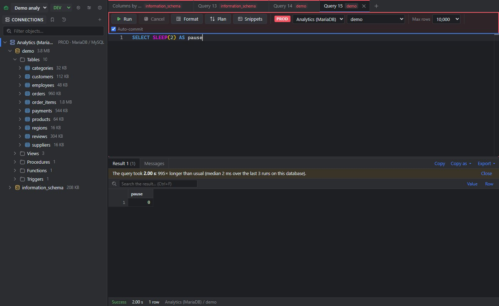

*Close* hides the bar.

---

## 21. Settings

Some of QuCore's behaviors are a trade-off between safety and speed, e.g. the confirmation before writing on production or Auto-commit. **You decide** how you want them. The defaults match how QuCore behaved before settings existed, so nothing changes until you change it. One default carries a risk itself and therefore shows a warning right away: Auto-commit on production is on.

1. Click the **settings** icon (sliders) next to the project picker, or press **Ctrl+,**.
2. Change what you want. Every setting says what it does, and when you pick a riskier value a **yellow warning** explains what you risk. Changed settings are marked *changed*.
3. **Save**. *Restore defaults* puts every setting back to its default (you still need to Save).

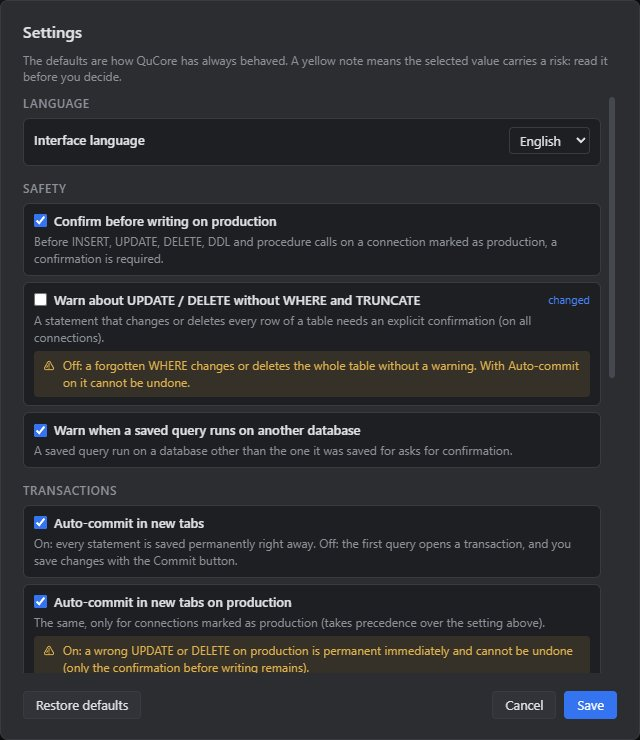

| Setting | Default | Risk if you change it |
|---|---|---|
| Confirm before writing on production | on | writes on production run immediately, without asking |
| Warn about UPDATE / DELETE without WHERE and TRUNCATE | on | a forgotten WHERE changes or deletes the whole table without a warning |
| Warn when a saved query runs on another database | on | a saved query silently runs on the wrong database |
| Auto-commit in new tabs | on | off: even a SELECT opens a transaction that keeps rows locked until you click Commit/Rollback |
| Auto-commit in new tabs on production | on | on: a wrong UPDATE on production is permanent immediately; off: remember to close the transaction |
| Highlight an open transaction after | 5 min | longer: you notice a transaction blocking others later |
| Ctrl+Enter runs | the statement at the cursor | *the whole editor*: it is easy to run a statement you did not mean to |
| A blank line separates statements | on | off: two statements without `;` become one |
| Restore open tabs at startup | on | on: tab text is unencrypted in the profile; off: unsaved text is lost |
| Max rows in new tabs | 10,000 | more rows use more memory |
| Suggestion "Save it?" | on | — |
| Warnings after running | on | off: you do not see that a query suddenly got slower or empty |

Good to know:

- Auto-commit and Max rows apply to **tabs you open after the change**; open tabs keep theirs (you can also change them in the toolbar).
- The other settings apply right away, in every tab.
- Settings are stored in the app profile (see [Where your data is](#23-where-your-data-is)).

### Interface language

QuCore works in **English** and **Croatian**. Choose the language at the top of Settings, in the *Language* section.

1. Open Settings (**Ctrl+,**).
2. In *Interface language* choose *English* or *Hrvatski*.
3. Click **Save and restart**. QuCore closes and starts again in the new language.

Good to know:

- If a tab has an open transaction, you get the usual question before closing (Commit / Rollback / Cancel). *Cancel* also cancels the language switch: the app stays open, and the new language applies from the next start.
- Open tabs and their unsaved text come back if *Restore open tabs at startup* is on. Tabs keep their titles (e.g. *Upit 3* stays *Upit 3* in English).
- First start: an existing profile stays in Croatian, and a new profile follows the system language (Croatian if Windows is in Croatian, otherwise English).
- The language also changes the messages QuCore writes itself (e.g. *5 rows affected*, errors when saving). Messages sent by the server itself (e.g. an SQL error) stay in the server's language.
- *Restore defaults* does not change the language.
- This guide follows the interface language too.

---

## 22. Shortcuts

| Shortcut | Action |
|---|---|
| **Ctrl+Enter** / **Ctrl+E** | run the statement at the cursor (or the selection) |
| **F5** / **Alt+X** | run the whole editor (or the selection) |
| **Esc** | cancel the query |
| **Ctrl+T** / **Ctrl+W** | new / close tab |
| **Ctrl+Tab** / **Ctrl+Shift+Tab** | next / previous tab |
| **Ctrl+O** | open a .sql file (or drag it into the window) |
| **Ctrl+S** | save the query (or save changes to a saved one); in a file tab, save to the file |
| **Ctrl+Shift+S** | save as a new query |
| **Ctrl+P** | saved queries and projects |
| **Ctrl+Shift+P** | switch project |
| **Ctrl+Space** | suggestions (tables, columns) |
| **F1** | guide |
| **Shift+Alt+F** | format SQL |
| **Ctrl+Shift+E** | execution plan of the statement at the cursor |
| **Ctrl+F** / **Ctrl+H** (in the editor) | find / find and replace |
| **F3** / **Shift+F3** | next / previous match |
| **Ctrl+D** | also select the next occurrence (multiple cursors) |
| **Ctrl+,** | settings |
| **Ctrl+C** (in the result grid) | copy cell |
| **Ctrl+A** (in the result grid) | copy all rows with column names |
| **Ctrl+F** (in the result grid) | search the result (filter) |
| **Shift+Enter** (in the result grid) | full cell value (panel on the right) |
| **F2** / double-click | edit cell (data editing) |
| Middle click on a tab | close the tab |
| Double-click a table | first 100 rows |
| Double-click a column | insert the name into the editor |

---

## 23. Where your data is

Everything is in the `%APPDATA%\QuCore` folder. If you used a version older than 0.17, the app renames the old `%APPDATA%\SQL Studio` folder to `QuCore` on first start; connections, passwords and history are kept.

| File | Contents |
|---|---|
| `connections.json` | connections; passwords encrypted (Windows DPAPI) |
| `qucore.db` | projects, saved queries, versions, history, snippets, variable values (SQLite) |
| `Local Storage` | settings, open tabs and their unsaved text (if restoring tabs is on), the active project (browser data inside the app) |
| `file-grants.json` | the .sql files you opened or saved through QuCore; *Save to file* may write only to these without a dialog |
| `history.jsonl.imported` | old history from versions up to 0.9 (a backup copy, can be deleted) |

**Backup:** close QuCore and copy the whole folder. Query text in the history and in open tabs is not encrypted.

Why `file-grants.json`: QuCore reads and saves only files you chose yourself (the *Open* dialog, *Save as* or dragging into the window). A tab with a file opened in a version older than 0.19 therefore saves the first time through *Save to file as…*; after that Ctrl+S works as before.

---

## 24. FAQ

**The query does not run, a window opens instead.** That is the variables form (chapter 16) or a safety confirmation (chapter 19).

**I do not see a database in the Explorer.** Check the project picker at the top: the active project hides databases that do not belong to it. Choose *All projects*.

**Windows sign-in says there is no ODBC driver.** Install *ODBC Driver 18 for SQL Server* from Microsoft and restart QuCore.

**The query returns only part of the rows.** *Max rows* was reached; use *Load more* or raise *Max rows* in the toolbar.

**A saved query has a ⚠.** A table it uses was not found when the database was last opened in the Explorer. Check the tooltip (which table, where) and fix the query; saving clears the old warning.

**How do I restore an older version of a query?** Right-click → *Versions and runs…* → choose a version → *Restore this version*.
