# QuCore — korisnički vodič

*The Power Behind Every Query.* Ovaj vodič objašnjava sve što QuCore radi, korak po korak, kao da ga otvaraš prvi put.
Vrijedi za verziju **0.19**. Isti vodič je i u samoj aplikaciji: **F1** ili **?** pored izbora projekta. Snimke zaslona su s izmišljenih demo podataka: baza `demo` je mala web trgovina (kupci, proizvodi, narudžbe, plaćanja), a projekt se zove *Demo analitika*.

> **Pravilo održavanja:** svaka nova funkcionalnost dodaje se u ovaj vodič i u engleski `README.en.md` u istom releaseu.

## Sadržaj

1. [Što je QuCore](#1-što-je-qucore)
2. [Prvo pokretanje](#2-prvo-pokretanje) (i vodič u aplikaciji)
3. [Konekcije](#3-konekcije)
4. [Explorer — preglednik baze](#4-explorer--preglednik-baze)
5. [Editor i izvršavanje upita](#5-editor-i-izvršavanje-upita)
6. [Rezultati](#6-rezultati)
7. [Uređivanje podataka u tablici](#7-uređivanje-podataka-u-tablici)
8. [ER dijagram](#8-er-dijagram)
9. [Povijest upita](#9-povijest-upita)
10. [Projekti](#10-projekti)
11. [Spremljeni queryji](#11-spremljeni-queryji)
12. [Pretraga i filteri](#12-pretraga-i-filteri)
13. [Verzije i trend izvršavanja](#13-verzije-i-trend-izvršavanja)
14. [„Spremiti ga?“ — prijedlog spremanja](#14-spremiti-ga--prijedlog-spremanja)
15. [Okruženja i aliasi baza](#15-okruženja-i-aliasi-baza)
16. [Varijable u upitima](#16-varijable-u-upitima)
17. [Snippeti](#17-snippeti)
18. [Brzo traženje (Ctrl+P)](#18-brzo-traženje-ctrlp)
19. [Zaštita: produkcija, upiti bez WHERE, kriva baza](#19-zaštita-produkcija-upiti-bez-where-kriva-baza)
20. [Upozorenja nakon izvršavanja](#20-upozorenja-nakon-izvršavanja)
21. [Postavke](#21-postavke)
22. [Prečaci](#22-prečaci)
23. [Gdje su moji podaci](#23-gdje-su-moji-podaci)
24. [Česta pitanja](#24-česta-pitanja)

---

## 1. Što je QuCore

QuCore je desktop SQL editor za **SQL Server, PostgreSQL i MariaDB/MySQL**. U jednom prozoru imaš:

- popis konekcija i preglednik baza (tablice, viewovi, procedure…),
- editor upita s prijedlozima, formatiranjem i više tabova,
- rezultate koji stižu dok upit još traje,
- **projekte** u kojima držiš spremljene upite, povijest i baze jednog posla (npr. *AML*),
- zaštitu od nehotičnih izmjena na produkciji.

Prozor ima dva dijela: **sidebar** lijevo (projekt, Konekcije / Spremljeno / Povijest) i **radni dio** desno (tabovi s upitima).

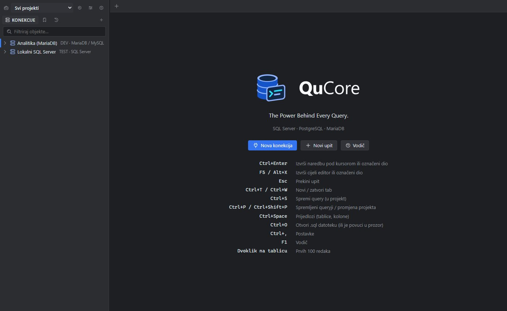

---

## 2. Prvo pokretanje

1. Pokreni instalaciju `QuCore Setup x.y.z.exe` i odaberi mapu (ili ostavi zadanu). Na macOS-u otvori `.dmg` i povuci QuCore u *Applications*; na Linuxu pokreni `.AppImage` (`chmod +x` prvi put).
2. Otvori **QuCore**. Vidiš početni zaslon s gumbima **Nova konekcija** i **Novi upit**.
3. Klikni **Nova konekcija** i upiši podatke svoje baze (poglavlje 3).
4. Kad se konekcija pojavi lijevo, klikni na nju — QuCore se spoji i pokaže baze.

> **Upozorenje sustava pri prvom pokretanju:** instalacija još nije potpisana certifikatom. Windows (SmartScreen): **Više informacija** → **Ipak pokreni**. macOS: u Finderu desni klik na QuCore → **Open** → **Open** (samo prvi put).

> Na vrhu sidebara je izbor projekta. Dok ne napraviš projekt, stoji **Svi projekti** — to znači „bez filtra, vidi se sve“.

### Vodič u aplikaciji

Ovaj vodič je ugrađen u QuCore i radi bez interneta:

1. Pritisni **F1** (radi i dok pišeš u editoru), ili klikni **?** pored izbora projekta, ili **Vodič** na početnom zaslonu.
2. Otvara se tab **Vodič**: lijevo su poglavlja (trenutno poglavlje je istaknuto), desno tekst sa slikama.
3. **Traži u vodiču…** sužava popis na poglavlja koja sadrže upisani tekst; **Enter** skače na prvo.
4. Linkovi u sadržaju vode na poglavlje unutar taba. Tab zatvaraš kao i svaki drugi (**Ctrl+W**).

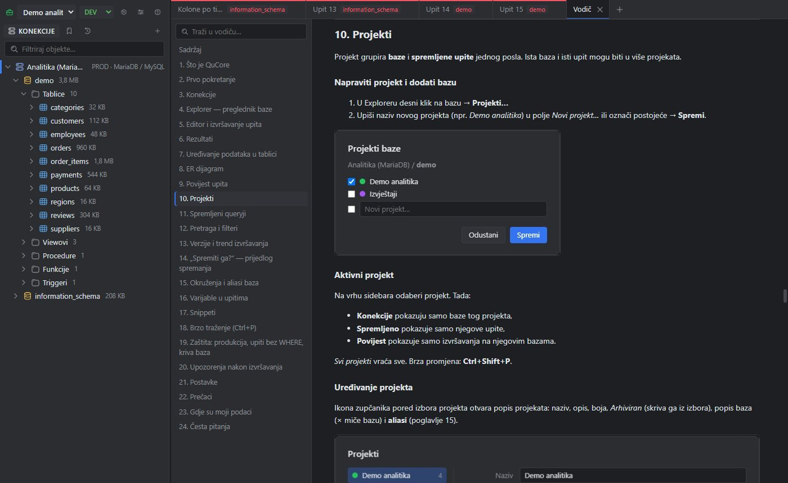

---

## 3. Konekcije

### Nova konekcija

1. Sidebar → tab **Konekcije** (ikona servera) → **+** gore desno (ili gumb *Nova konekcija*).
2. Odaberi vrstu: **SQL Server**, **PostgreSQL** ili **MariaDB / MySQL**.
3. Upiši **Naziv** (kako će se zvati u popisu, npr. *Produkcija ERP*), **Host** i **Port** (zadani port se upiše sam).
4. Upiši **Korisnika** i **Lozinku** (ili odaberi Windows prijavu, vidi dolje).
5. **Baza** je opcionalna — ako je upišeš, novi upiti se otvaraju na njoj.
6. **Sigurnost**: za SQL Server *Enkripcija (TLS)* i *Vjeruj certifikatu servera*; za ostale *SSL*.
7. **Okruženje**: *dev*, *test*, *prod* ili *bez oznake*. Oznaka *prod* uključuje zaštitu (poglavlje 19).
8. **Boja**: npr. crvena za produkciju — boja se vidi uz konekciju i na tabovima.
9. Klikni **Testiraj**. Zelena poruka s verzijom servera = sve je u redu. Zatim **Spremi**.

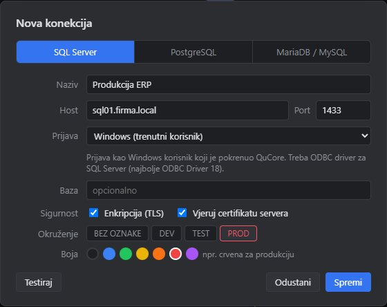

### SQL Server: načini prijave

| Prijava | Kad je koristiti | Što upisati |
|---|---|---|
| **SQL Server login** | korisnik i lozinka na samom serveru | korisnik + lozinka |
| **Windows (trenutni korisnik)** | firma koristi Windows/domenske račune, prijavljen si na računalo svojim računom | ništa — koristi se tvoj Windows račun |
| **Windows (domena\korisnik)** | treba drugi domenski račun | domena (ili `FIRMA\ivan` u polju Korisnik) + lozinka |

Za *Windows (trenutni korisnik)* na računalu mora biti ODBC driver za SQL Server (najbolje *ODBC Driver 18 for SQL Server*, besplatan s Microsoftove stranice). QuCore sam izabere najnoviji instalirani.

### Uređivanje i brisanje

Desni klik na konekciju → **Uredi konekciju…**, **Osvježi**, **Odspoji**, **Obriši konekciju**.
Lozinke se spremaju kriptirano (Windows zaštita podataka, macOS Keychain ili Linux secret service), nikad kao čitljiv tekst. Windows prijava na SQL Server radi samo na Windowsu.

> **Linux bez keyringa:** ako sustav nema GNOME Keyring ili KWallet, lozinka se može spremiti samo prikriveno (čita je svatko tko može čitati mapu profila). Dijalog konekcije to tada pokaže žutim upozorenjem ispod lozinke. Instaliraj i otključaj keyring pa ponovno pokreni QuCore, ili koristi korisnika baze s ograničenim pravima.

---

## 4. Explorer — preglednik baze

Klik na konekciju je otvara: vidiš baze s veličinom, unutar baze mape **Tablice, Viewovi, Procedure, Funkcije, Triggeri**, a unutar tablice kolone (ključ = primarni ključ, tip, *not null*, *identity*).

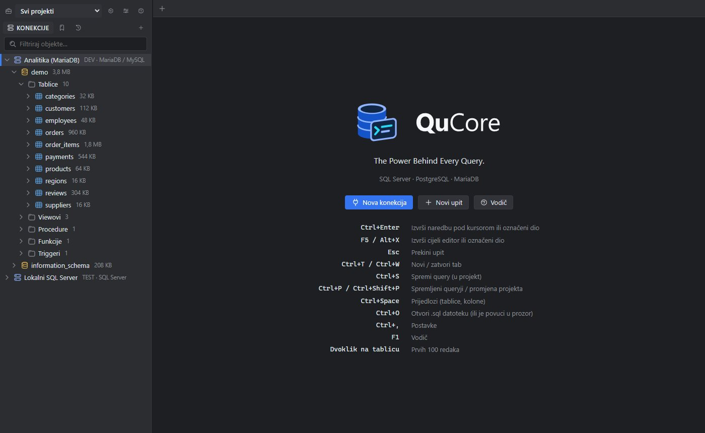

- **Filtriraj objekte…** (polje na vrhu) skriva sve što ne sadrži upisani tekst.
- **Dvoklik na tablicu** otvara novi tab s *prvih 100 redaka* i odmah ga izvrši.
- **Dvoklik na kolonu** ubacuje njezin naziv u editor.
- **Desni klik na tablicu**: *Otvori tablicu (struktura i podaci)*, *SELECT prvih 100 redaka*, *Broj redaka*, *Generiraj SELECT / INSERT / UPDATE / DELETE* (vidi niže), *Skripta (CREATE)*, *Ubaci naziv u editor*, *Kopiraj naziv*.

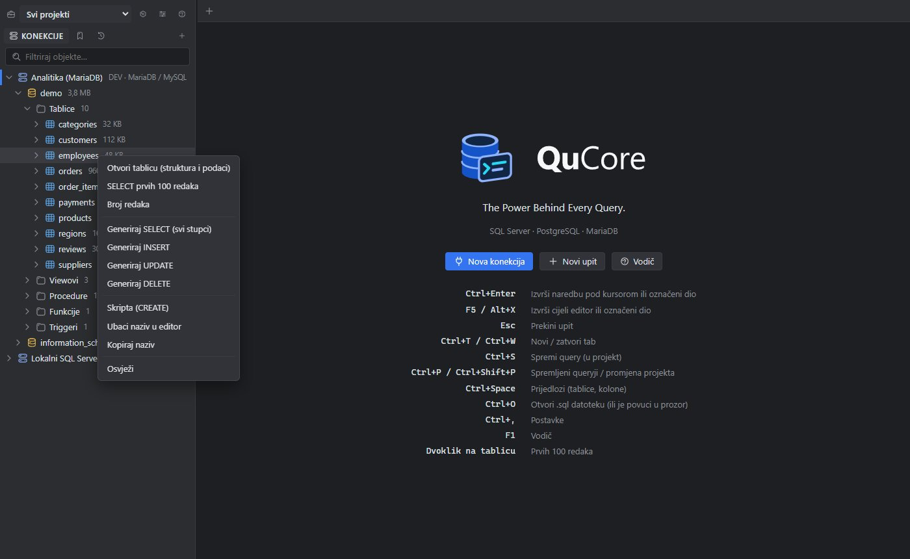

- **Desni klik na bazu**: *Novi upit*, *ER dijagram*, *Projekti…*, *Osvježi*.

### Tab tablice: kolone, podaci, indeksi, strani ključevi, DDL

Desni klik na tablicu (ili view) → **Otvori tablicu (struktura i podaci)** otvara tab sa svime o toj tablici na jednom mjestu:

| Kartica | Što pokazuje |
|---|---|
| **Kolone** | naziv, tip, *NOT NULL*, zadana vrijednost, primarni ključ i *identity* |
| **Podaci** | prvih 100 redaka — isti editor i tablica kao u običnom tabu (uređivanje, filter, export, transakcije); upit se izvrši tek kad otvoriš ovu karticu |
| **Indeksi** | svaki indeks sa stupcima redom, *PK* / *UNIQUE*, vrsta (BTREE, CLUSTERED…) i INCLUDE stupci (SQL Server) |
| **Strani ključevi** | *Ova tablica upućuje na* i *Na ovu tablicu upućuju* — klik na naziv druge tablice otvara njezin tab |
| **DDL** | `CREATE` skripta (*Kopiraj* ili *Otvori u novom tabu*) |

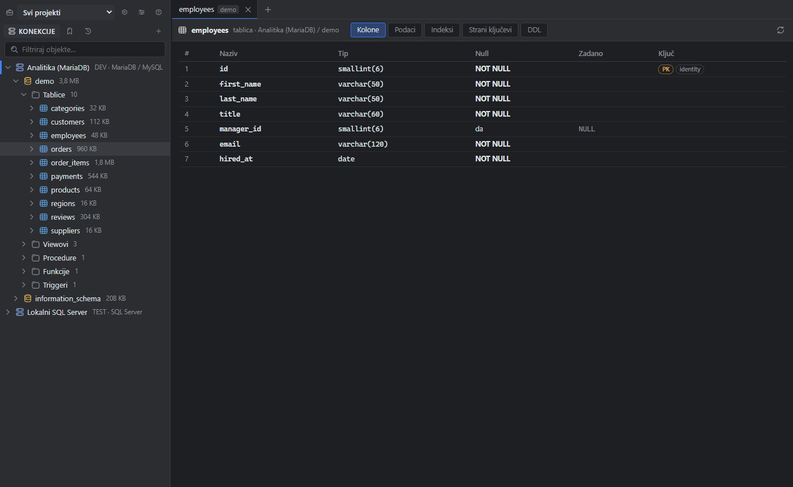

- Ista tablica se ne otvara dvaput — ponovno *Otvori tablicu* samo aktivira njezin tab.
- **Osvježi** (ikona desno) ponovno učita strukturu nakon `ALTER TABLE`.
- Dvoklik na tablicu i dalje otvara običan tab s prvih 100 redaka.
- Viewovi imaju kartice Kolone, Podaci i DDL.

### Generiranje SQL-a za tablicu

Desni klik na tablicu → **Generiraj …** otvara novi tab s gotovim predloškom (ništa se ne izvršava):

| Stavka | Što dobiješ |
|---|---|
| *Generiraj SELECT (svi stupci)* | `SELECT` sa svim stupcima navedenim po imenu (umjesto `*`), prvih 100 redaka — lako je maknuti stupce koje ne trebaš. Radi i za viewove. |
| *Generiraj INSERT* | svi stupci osim *identity* / *auto_increment* (njih baza sama puni); uz svaku vrijednost komentar s tipom, *not null* i zadanom vrijednošću |
| *Generiraj UPDATE* | `SET` za sve stupce osim ključa, `WHERE` po primarnom ključu |
| *Generiraj DELETE* | `WHERE` po primarnom ključu |

Vrijednosti su **varijable** (`:naziv`, vidi [Varijable u upitima](#16-varijable-u-upitima)): kad izvršiš predložak, QuCore otvori dijalog u koji upišeš vrijednosti. Primjer za tablicu `orders` s ključem `id`:

```sql
UPDATE orders
SET
    status = :status,
    total = :total
WHERE id = :id;
```

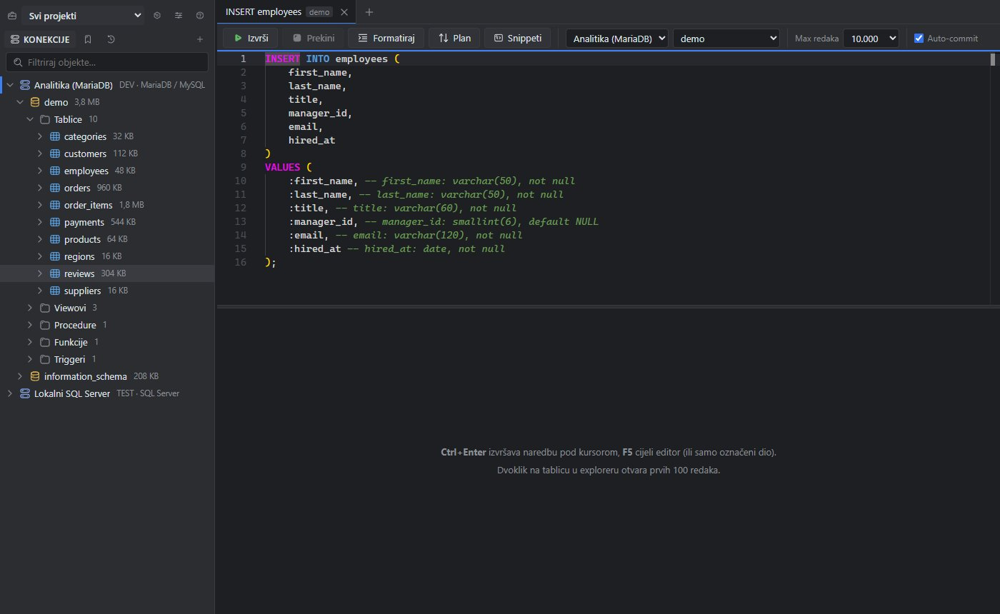

> Ako tablica **nema primarni ključ**, UPDATE i DELETE dobiju `WHERE 1 = 0` s komentarom — takva naredba ne mijenja ništa dok ne napišeš pravi uvjet. Zaštita od UPDATE/DELETE bez WHERE (poglavlje 19) i potvrda na produkciji vrijede i za generirane naredbe.

---

## 5. Editor i izvršavanje upita

### Otvaranje taba

- **Ctrl+T** ili **+** pored tabova — novi upit na istoj konekciji kao aktivni tab.
- Dvoklik na bazu u Exploreru — novi upit na toj bazi.
- U toolbaru taba biraš **konekciju** i **bazu** (padajući izbornici).

**Tabovi se pamte.** Kad zatvoriš QuCore i ponovno ga otvoriš, vraćaju se svi otvoreni tabovi — s tekstom koji si upisao (i ako ga nisi spremio), položajem kursora, konekcijom i bazom. Upiti se pri tome **ne izvršavaju** i rezultati se ne vraćaju; pritisni **F5** ili **Ctrl+Enter** kad trebaš. ER dijagram se učitava tek kad otvoriš njegov tab. Ako je konekcija u međuvremenu obrisana, tab ostaje bez konekcije — odaberi novu u toolbaru.

### .sql datoteke s diska

Skriptu koju si dobio kao datoteku (ili je trebaš nekome poslati) otvaraš i spremaš izravno:

1. **Ctrl+O** (ili povuci jednu ili više `.sql` / `.txt` datoteka mišem u prozor QuCorea). Svaka datoteka se otvori u svom tabu, s nazivom datoteke kao naslovom i konekcijom aktivnog taba.
2. Mijenjaj tekst — pored naziva taba pojavi se **●** (nespremljene izmjene).
3. **Ctrl+S** sprema natrag u istu datoteku i ● nestaje.
4. Desni klik na tab → **Spremi u datoteku kao…** sprema u novu datoteku (radi i za običan tab — tada on postaje tab te datoteke).

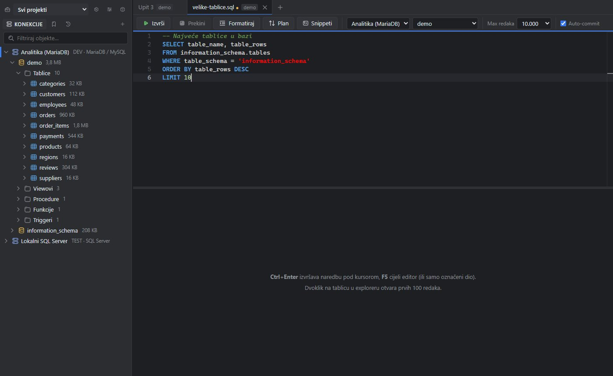

Korisno je znati:

- **Kodiranje se zadržava.** QuCore prepoznaje UTF-8 (s BOM-om i bez), UTF-16 (SSMS ga koristi kad sprema kao „Unicode“) i stari Windows-1250, i sprema u istom. Kad otvoriš datoteku koja nije obični UTF-8, to javi poruka. Ako u Windows-1250 datoteku upišeš znak koji to kodiranje nema (npr. emoji), spremi se kao UTF-8 s BOM-om i to piše u poruci.
- **Zatvaranje taba s ●** pita: *Spremi*, *Ne spremaj* ili *Odustani*. *Zatvori ostale* ne zatvara datoteke s nespremljenim izmjenama.
- Ista datoteka se ne otvara dvaput — Ctrl+O na već otvorenu samo je aktivira.
- U tabu datoteke **Ctrl+S sprema u datoteku**, ne u spremljene upite. Da je dodaš u projekt, koristi **Ctrl+Shift+S** (spremi kao novi upit).
- Datoteke veće od 20 MB se ne otvaraju (editor za njih nije prikladan).
- Ako su uključeni [vraćeni tabovi](#21-postavke), tab datoteke se vraća i nakon ponovnog pokretanja, zajedno s nespremljenim izmjenama i oznakom ●.

### Izvršavanje

1. Upiši SQL, npr.:
   ```sql
   SELECT table_name, table_rows
   FROM information_schema.tables
   ORDER BY table_rows DESC
   LIMIT 20
   ```
2. Pritisni **Ctrl+Enter** — izvršava se samo **naredba na kojoj stoji kursor** (na trenutak se istakne u editoru).
3. **F5**, **Alt+X** ili gumb *Izvrši* izvršavaju **cijeli editor**.
4. Ako **označiš** dio teksta, uvijek se izvršava samo označeno (i s Ctrl+Enter i s F5).
5. **Esc** ili *Prekini* zaustavlja upit — retci koji su već stigli ostaju u tablici.

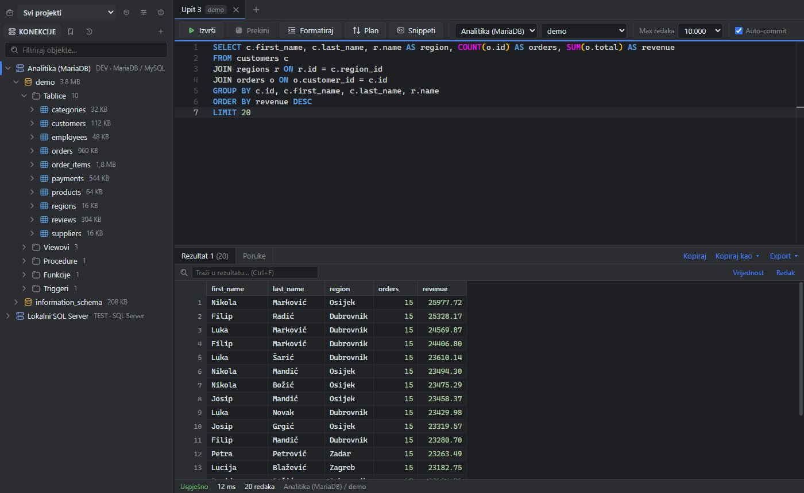

Kako QuCore zna gdje naredba počinje i završava (za **Ctrl+Enter**):

- naredbe dijeli **`;`** ili **prazan redak**, a na SQL Serveru i **`GO`**;
- `;` unutar stringa, komentara ili `BEGIN … END` / `CASE … END` bloka ne dijeli;
- SQL Server `CREATE/ALTER PROCEDURE`, `FUNCTION`, `TRIGGER` i `VIEW` ide do idućeg `GO`, a MariaDB blok `DELIMITER $$ … DELIMITER ;` ide cijeli;
- ako je kursor na praznom retku između dvije naredbe odvojene praznim retcima, ne izvršava se ništa — pomakni kursor na naredbu.

Primjer — kursor na drugom retku, **Ctrl+Enter** izvršava samo `SELECT COUNT(*) FROM orders;`:

```sql
SELECT * FROM customers WHERE id = 7;
SELECT COUNT(*) FROM orders;

UPDATE orders SET status = 'x' WHERE id = 1
```

Korisno je znati:

- Više naredbi odjednom radi (svaka daje svoj *Rezultat* tab). SQL Server razumije `GO`, MariaDB `DELIMITER`.
- Svaki tab ima **svoju sesiju** — privremene tablice i transakcije ostaju između izvršavanja u istom tabu.
- **Max redaka** (toolbar) ograničava koliko redaka se prikazuje po rezultatu.

### Transakcije: Auto-commit, Commit, Rollback

Zadano je uključen **Auto-commit**: svaka naredba se odmah trajno sprema u bazu. Kad radiš osjetljive izmjene (npr. ručni `UPDATE` na produkciji), isključi ga pa izmjene najprije provjeri, a tek onda spremi.

1. U toolbaru taba makni kvačicu **Auto-commit**.
2. Izvrši upit (npr. `UPDATE orders SET status = 'x' WHERE id = 1`). Prvi upit otvara transakciju i u toolbaru se pojavi oznaka **Transakcija · 1 izvršavanje · 0:05** s gumbima **Commit** i **Rollback**.
3. Provjeri rezultat (npr. `SELECT * FROM orders WHERE id = 1`) — u ovom tabu vidiš izmjenu, a drugi korisnici i drugi tabovi je **ne vide** dok ne napraviš Commit.
4. **Commit** trajno sprema sve izmjene iz transakcije. **Rollback** ih sve poništava.
5. Sljedeći upit otvara novu transakciju (dok je Auto-commit isključen).

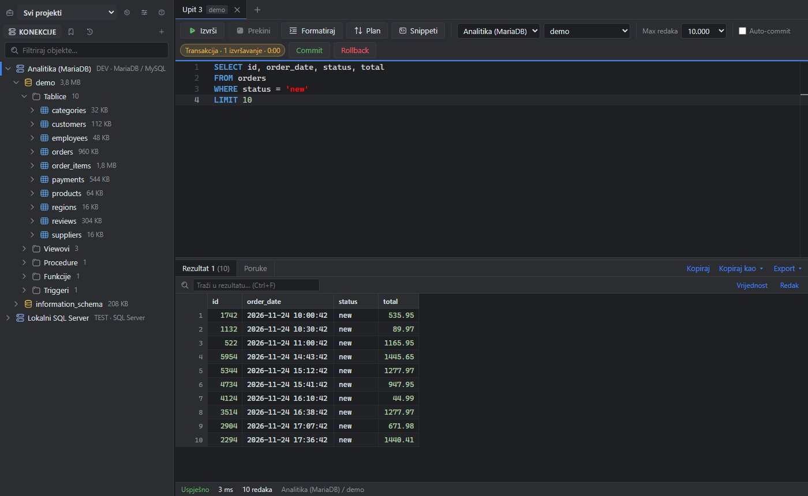

Što još treba znati:

- **Oznaka broji izvršavanja i vrijeme** otkad je transakcija otvorena. Nakon 5 minuta postaje jače istaknuta: otvorena transakcija drži zaključane retke i drugi upiti na njih čekaju — ne ostavljaj je otvorenu dulje nego treba.
- Uz isključen Auto-commit transakciju otvara i običan `SELECT`.
- **Crvena oznaka „Transakcija u grešci“** (PostgreSQL, a na SQL Serveru uz `SET XACT_ABORT ON`): neka naredba nije uspjela i baza više ne prihvaća izmjene u toj transakciji — moguć je samo **Rollback**.
- Transakciju prepoznaje i kad je otvoriš sam (`BEGIN`, `BEGIN TRAN`, `START TRANSACTION`) uz uključen Auto-commit. Ako je zatvoriš u upitu (`COMMIT` / `ROLLBACK`), oznaka nestane i u *Porukama* piše da transakcija više nije otvorena — isto i kad je zatvori naredba koja sama radi commit (na MariaDB npr. `CREATE` / `ALTER` / `DROP`) ili kad pukne veza.
- **Zatvaranje taba ili aplikacije, odspajanje i brisanje konekcije** s otvorenom transakcijom traže odluku: *Commit i zatvori*, *Rollback i zatvori* ili *Odustani*. Promjena konekcije ili baze u toolbaru pita za potvrdu i radi Rollback.
- **Commit nije moguć dok rezultat čeka ostatak redaka** (*Max redaka*): najprije *Učitaj još* do kraja ili ga zatvori. Na PostgreSQL-u zatvaranje takvog rezultata prekida upit, a to ruši cijelu transakciju (dobiješ crvenu oznaku).
- **Spremanje izmjena iz tablice** (poglavlje 7) ide preko zasebne veze, pa je zabranjeno dok je transakcija otvorena — napravi Commit ili Rollback pa spremi.
- Kvačica Auto-commit pamti se po tabu (i nakon ponovnog pokretanja); otvorena transakcija se ne pamti — zatvaranje aplikacije je uvijek zatvara.
- Kako se otvaraju novi tabovi (s Auto-commitom ili bez, posebno za produkciju) biraš u [Postavkama](#21-postavke).

### Plan izvršavanja (zašto je upit spor)

Plan pokazuje **kako** baza izvršava upit: koje tablice čita cijele, koje preko indeksa, kako ih spaja i sortira.

1. Stavi kursor na naredbu (ili je označi) i pritisni **Ctrl+Shift+E** ili gumb **Plan** u toolbaru.
2. U donjem dijelu otvori se kartica **Plan**: stablo operacija s detaljima (tablica, indeks, uvjet, način pristupa), **procijenjenim troškom** i **procijenjenim brojem redaka**. Upit se pri tome **ne izvršava**.
3. Korak s najvećim vlastitim troškom označen je crveno kao **najskuplje** — tamo obično treba indeks ili drugačiji uvjet.
4. **Izvrši s ANALYZE** (PostgreSQL i MariaDB) stvarno izvrši upit i doda **stvarne retke** i **vrijeme u ms** po koraku; *najskuplje* tada znači najviše vlastitog vremena. Kad se stvarni broj redaka razlikuje od procjene 10 ili više puta, broj je žut — baza je krivo procijenila (često zastarjele statistike).

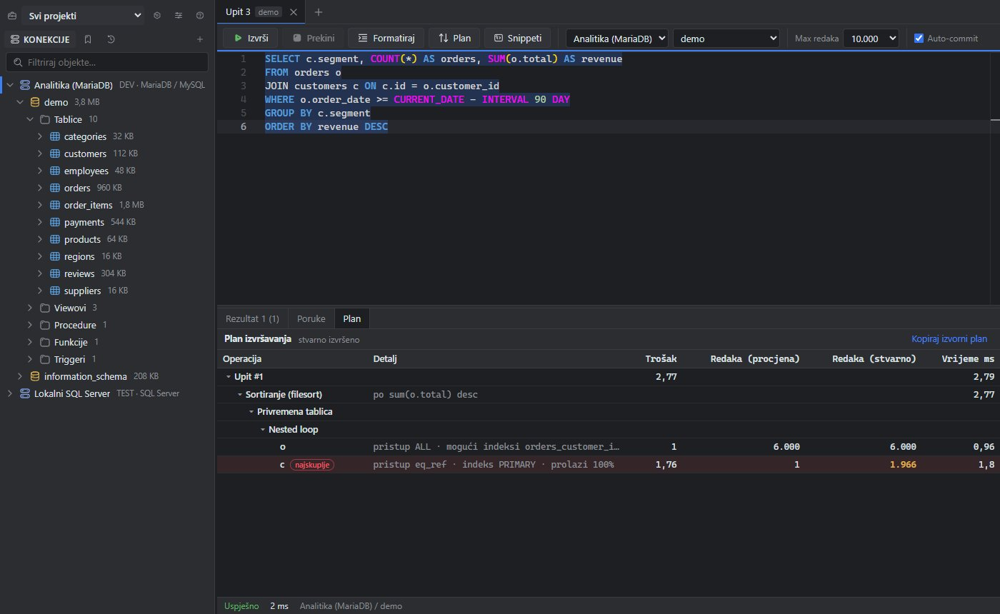

Korisno je znati:

- Plan se radi za **jednu naredbu**. Upit s varijablama (`:x`) najprije izvrši ili zamijeni varijable vrijednostima.
- **ANALYZE je dopušten samo za SELECT**, jer stvarno izvršava naredbu (UPDATE / DELETE bi promijenili podatke). Za ostale naredbe koristi plan bez ANALYZE — on ne mijenja ništa.
- SQL Server prikazuje **procijenjeni** plan (bez ANALYZE).
- **Kopiraj izvorni plan** kopira plan kako ga je baza vratila (JSON ili XML) — za dijeljenje ili vanjske alate za analizu planova.
- Plan se radi na istoj sesiji kao i upiti taba (ista baza, privremene tablice, otvorena transakcija).

### Prijedlozi (autocomplete)

Tipkaj i pritisni **Ctrl+Space**: nude se tablice, kolone i ključne riječi. Razumije aliase: nakon `FROM orders o`, upis `o.` nudi kolone tablice *orders*.

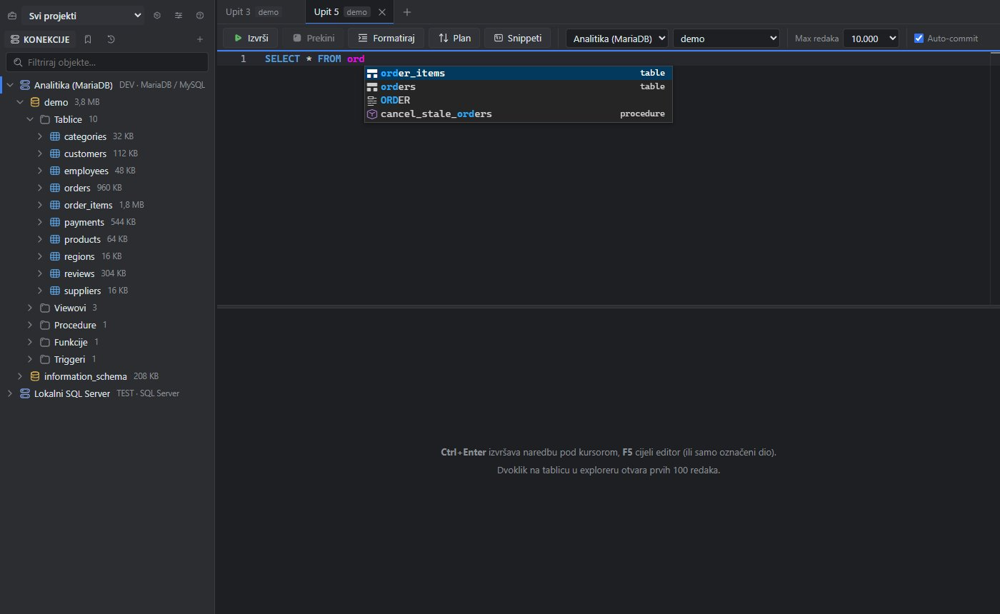

### Formatiranje

**Formatiraj** (ili **Shift+Alt+F**) uljepša SQL po pravilima dijalekta; ako je nešto označeno, formatira samo to.

### Traženje i zamjena u editoru

1. U editoru pritisni **Ctrl+F** i upiši tekst — svi pogoci se istaknu, a desno piše koji je trenutni i koliko ih ima (npr. *2 of 4*).
2. **Enter** ili **F3** ide na sljedeći pogodak, **Shift+Enter** / **Shift+F3** na prethodni. **Esc** zatvara traku.
3. **Ctrl+H** otvara i polje za zamjenu: upiši novi tekst pa **Enter** (zamijeni trenutni) ili **Ctrl+Alt+Enter** (zamijeni sve). Ctrl+Z vraća zamjenu.
4. Gumbi u traci: **Aa** razlikuje velika i mala slova, **ab** traži cijele riječi, **.*** prihvaća regularne izraze.

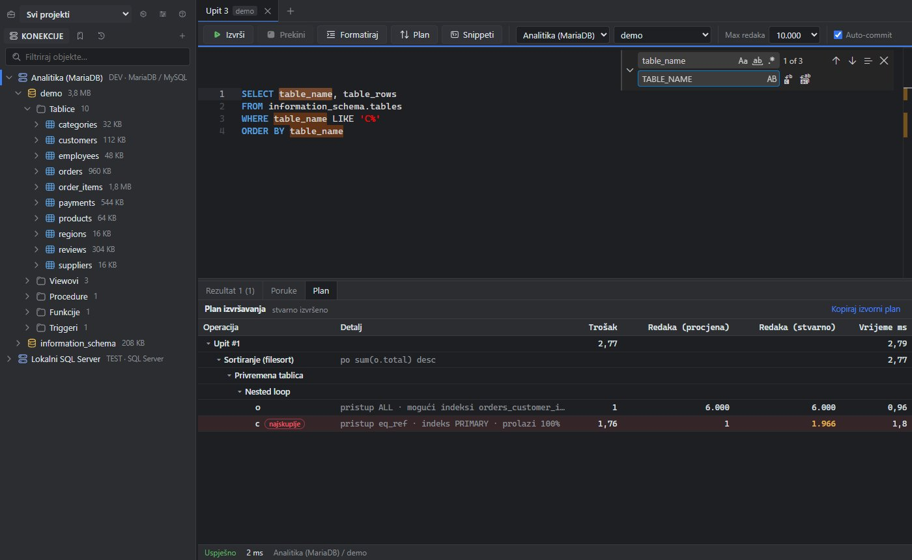

Korisno je znati:

- **Ctrl+D** označi riječ na kursoru, a svaki sljedeći Ctrl+D doda i iduće isto pojavljivanje s vlastitim kursorom — upisani tekst mijenja sva odjednom (brzo preimenovanje stupca u upitu).
- Natpisi u traci za traženje su na engleskom (dio editora).
- U **tablici rezultata** Ctrl+F traži u rezultatu (poglavlje 6), a u editoru u tekstu upita.

---

## 6. Rezultati

- Tablica je brza i sa 100.000 redaka. Klik na zaglavlje sortira, povlačenjem ruba mijenjaš širinu kolone.
- **Kopiraj**, **Kopiraj kao ▾** i **Export ▾** u traci iznad tablice kopiraju ili spremaju rezultat — vidi niže.
- Tab **Poruke**: PRINT, upozorenja, broj obuhvaćenih redaka, greške s brojem linije.

### Filtriranje rezultata

Iznad tablice je polje **Traži u rezultatu…**. Filtriranje radi nad retcima koji su već učitani, bez ponovnog izvršavanja upita.

**Brzo traženje**

1. Klikni u polje (ili **Ctrl+F** dok je fokus u tablici) i upiši tekst.
2. Ostaju samo retci u kojima **neka** kolona sadrži taj tekst (velika i mala slova nisu bitna); pogoci su istaknuti žuto.
3. **Enter** ili **↓** vraća fokus u tablicu, **Esc** briše traženje.

**Filter po stupcu** — desni klik na ćeliju:

| Stavka | Ostaju retci gdje je u tom stupcu… |
|---|---|
| *Filtriraj: = vrijednost* | točno ta vrijednost |
| *Filtriraj: ≠ vrijednost* | bilo što drugo, **uključujući NULL** |
| *Filtriraj: IS NULL* / *IS NOT NULL* | NULL / bilo koja vrijednost |

Svaki filter se pojavi kao **oznaka** pored polja (npr. `status = paid`); **×** ga uklanja. Filteri na različitim stupcima vrijede zajedno (i jedan i drugi); novi filter na istom stupcu zamijeni stari. Pored oznaka piše koliko je redaka prikazano, npr. **13 od 300**, a **Ukloni filtere** vraća sve.

Primjer: zadnjih 300 narudžbi, desni klik na `paid` u stupcu *status* → *Filtriraj: = paid*, pa u polje upiši `mobile` → ostaju plaćene narudžbe iz mobilne aplikacije.

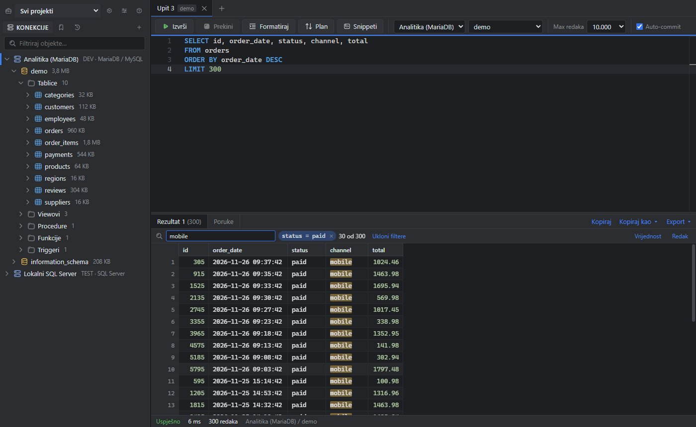

Korisno je znati:

- Sortiranje, svo kopiranje i **Export** rade nad **prikazanim** (filtriranim) retcima — i datoteka sadrži samo njih.
- Filtrira se po vrijednostima kako su stigle iz baze; neuspremljene izmjene (uređivanje podataka) ne utječu na filter, a novi retci se uvijek vide.
- Novo izvršavanje upita briše filtere. Ako je upit pauziran na *Max redaka*, filter vidi samo učitane retke — **Učitaj još** ih dodaje.

### Kopiranje rezultata (s nazivima stupaca)

Najbrže: klikni **Kopiraj** u traci iznad tablice. U međuspremnik idu **nazivi stupaca u prvom redu i svi prikazani retci** — točno onim redom kako ih vidiš (i nakon sortiranja). Gumb na trenutak pokaže *Kopirano: N redaka ✓*.

Zatim u Excelu ili Google Sheetsu klikni ćeliju i **Ctrl+V** — svaki stupac ide u svoj stupac (vrijednosti su odvojene tabulatorom).

Desni klik na ćeliju nudi i ostale načine:

| Stavka | Što kopira |
|---|---|
| *Kopiraj ćeliju* (**Ctrl+C**) | samo tu vrijednost |
| *Kopiraj redak* | cijeli redak, bez naziva stupaca |
| *Kopiraj redak s nazivima stupaca* | nazive stupaca + taj redak |
| *Kopiraj sve s nazivima stupaca* (**Ctrl+A** u tablici) | isto kao gumb *Kopiraj* |
| *Kopiraj sve bez naziva stupaca* | samo retke |
| *Kopiraj kao IN (…) listu* | vrijednosti stupca kao `('a', 'b', …)` za SQL |
| *Kopiraj redak kao INSERT* | `INSERT` naredba za taj redak |
| *Kopiraj sve kao INSERT* | `INSERT` naredbe za sve prikazane retke |

> Kopira se ono što je učitano u tablicu. Ako je upit pauziran na *Max redaka*, prvo **Učitaj još** ili povećaj *Max redaka*.

### Puna vrijednost ćelije i redak okomito

Ćelija u tablici prikazuje samo početak dugog teksta. Za cijelu vrijednost:

1. Odaberi ćeliju (klik ili strelice) i pritisni **Shift+Enter** — ili klikni **Vrijednost** desno u traci iznad tablice.
2. Desno se otvori panel s punom vrijednošću:
   - **JSON** i **XML** su formatirani (uvučeni i obojani), s mogućnošću sklapanja dijelova;
   - **dugi tekst** se prelama u retke i piše koliko ima znakova;
   - **binarni podaci** su prikazani kao hex s ASCII stupcem i veličinom u bajtovima;
   - **Kopiraj** kopira izvornu vrijednost.
3. Strelicama u tablici mijenjaš ćeliju — panel je prati. **Shift+Enter** ili **×** zatvara panel.

**Redak** (gumb u traci ili u panelu) prikazuje odabrani redak okomito, *stupac — vrijednost* — praktično za tablice s puno stupaca koje se ne vide odjednom. Strelice gore/dolje u tablici mijenjaju redak; klik na stupac u tom prikazu otvara njegovu punu vrijednost.

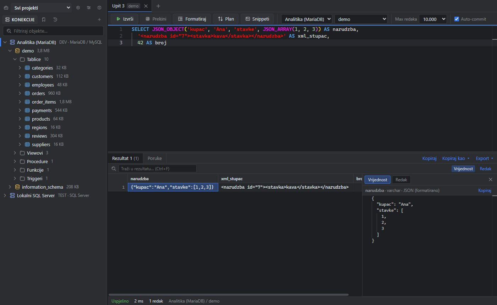

> Panel ostaje otvoren i za sljedeće izvršavanje. Vrijednosti se ovdje samo čitaju — uređuješ ih u tablici (poglavlje 7). Vrlo dugi binarni podaci stižu skraćeni, pa panel prikazuje njihov početak i napiše to.

### Kopiraj kao: INSERT, JSON, Markdown, CSV

**Kopiraj kao ▾** u traci iznad tablice kopira sve prikazane retke u drugom obliku:

| Oblik | Za što |
|---|---|
| **INSERT naredbe** | prijenos redaka u drugu bazu ili skriptu — jedna `INSERT` naredba po retku, s navodnicima i `NULL` po pravilima baze (SQL Server `N'…'`, binarni podaci kao `0x…`) |
| **JSON** | polje objekata (`[{"id": 1, "name": "…"}, …]`); brojevi su brojevi, NULL je `null` |
| **Markdown tablica** | za Jiru, Confluence, GitHub ili README; brojevi poravnati desno |
| **CSV** | odvojeno s `;` |

Naziv tablice u INSERT naredbama: ako je tab otvoren iz Explorera (dvoklik na tablicu), uzima se ta tablica; inače tablica iz upita ako je u njemu **samo jedna**. Ako je tablica nepoznata (JOIN više tablica), piše se `naziv_tablice` i pojavi se napomena — zamijeni ga.

Primjer: `SELECT id, name FROM customers WHERE id < 3` → *Kopiraj kao ▾ → INSERT naredbe*:

```sql
INSERT INTO customers (id, name) VALUES (1, 'Ana');
INSERT INTO customers (id, name) VALUES (2, 'O''Brien');
```

### Export u datoteku: CSV, Excel, JSON

**Export ▾** sprema prikazane retke u datoteku (QuCore pita gdje; naziv je naslov taba):

- **CSV (.csv)** — `;` kao razdjelnik; Excel ga otvara ispravno, i s našim slovima.
- **Excel (.xlsx)** — pravi Excel: brojevi su brojevi (može se zbrajati), datumi su datumi, zaglavlje je podebljano i zamrznuto, uključen je filter. Brojevi s više od 15 znamenki ostaju tekst jer bi ih Excel zaokružio.
- **JSON (.json)** — isto kao *Kopiraj kao → JSON*.

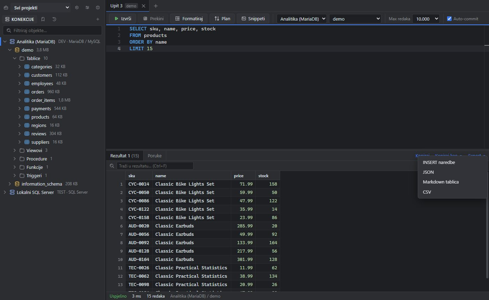

### Rezultat stiže u dijelovima („streaming“)

Prvi retci se pokažu odmah, dok upit još radi. Kad se dosegne *Max redaka*, upit se **pauzira** (ostaje otvoren na serveru) i dolje se pojavi traka:

- **Učitaj još N** — donosi sljedeću stranicu,
- **Prebroji ostatak** — pročita ostatak samo da kaže točan broj redaka,
- **Zatvori** — prekida upit na serveru.

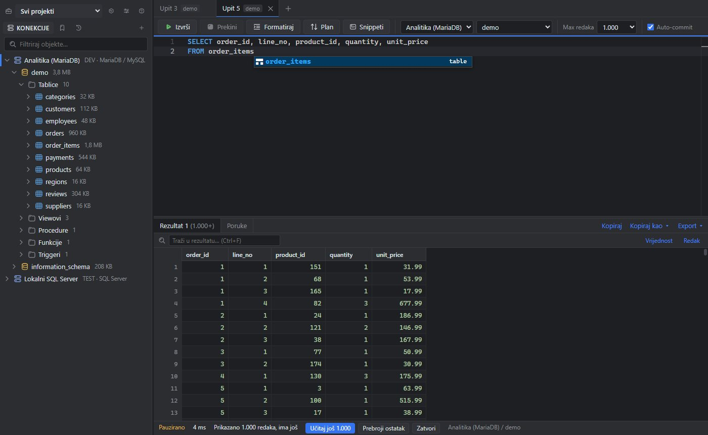

---

## 7. Uređivanje podataka u tablici

Radi za tablicu otvorenu iz Explorera (dvoklik ili *SELECT prvih 100 redaka*) koja ima **primarni ključ**.

1. Dvoklik (ili **F2**) na ćeliju → upiši novu vrijednost → **Enter**.
2. Desni klik na ćeliju: *Postavi NULL*, *Obriši redak*; dolje **+ Novi redak**.
3. Promijenjene ćelije su istaknute; gore piše broj izmjena.
4. **Spremi…** prikaže **točne SQL naredbe** koje će se izvršiti. Tek klik na *Spremi* u tom prozoru ih izvršava.
5. Sve ide u **jednoj transakciji**: svaka naredba mora pogoditi točno jedan redak, inače se ništa ne sprema.

Na produkcijskoj konekciji pregled ima i crvenu oznaku **PROD**. *Odbaci* poništava sve neprimijenjene izmjene.

---

## 8. ER dijagram

Desni klik na bazu → **ER dijagram**. Otvara se tab s tablicama (kolone, ključ, strani ključ) i vezama između njih.

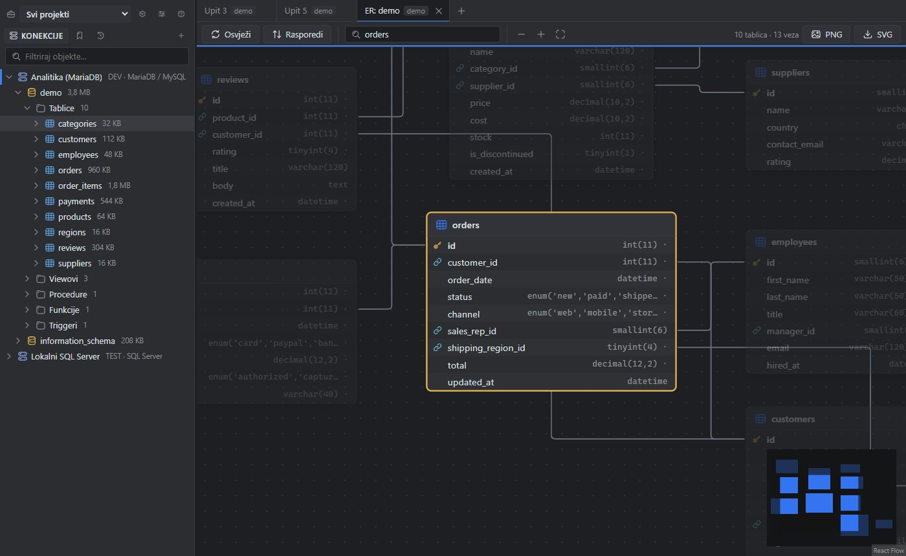

- **Pretraga** ističe tablice i kolone; **Enter** skače na prvu.
- Klik na tablicu ističe njezine veze.
- Gumbi: osvježi, ponovno rasporedi, filter sheme, zoom, prilagodi ekranu, mini-karta.
- **Izvoz**: SVG ili PNG cijelog dijagrama (ne samo vidljivog dijela).

---

## 9. Povijest upita

Sidebar → tab **Povijest** (ikona sata). Svako izvršavanje se bilježi: konekcija, baza, vrijeme, trajanje, broj redaka, greška ili *prekinuto*.

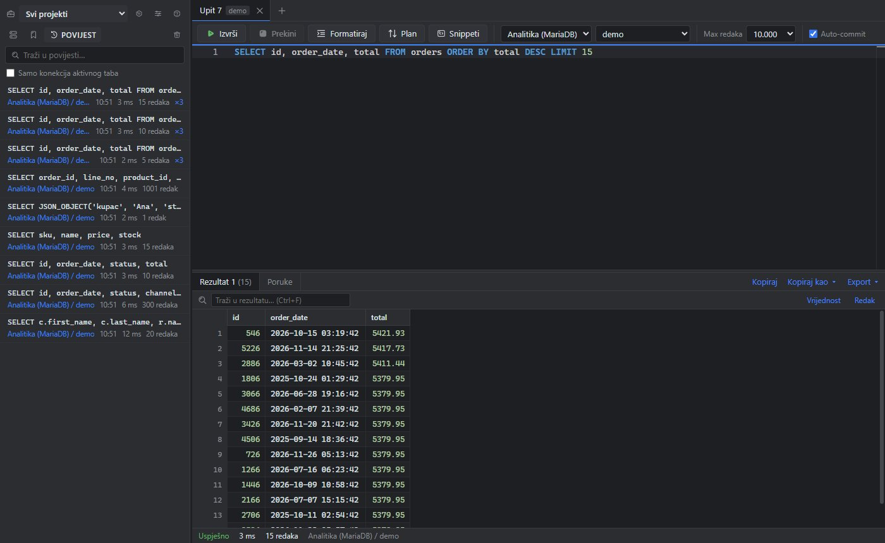

- **×N** znači da je isti upit pokrenut N puta — i kad su vrijednosti bile drukčije (`WHERE id = 5` i `WHERE id = 7` su isti upit).
- **Dvoklik** otvara upit u novom tabu (s vrijednostima varijabli koje su tada korištene).
- *Samo konekcija aktivnog taba* sužava popis; aktivni projekt ga također filtrira.
- Desni klik: ubaci u editor, kopiraj, obriši. Kanta gore briše cijelu povijest.

---

## 10. Projekti

Projekt grupira **baze** i **spremljene upite** jednog posla. Ista baza i isti upit mogu biti u više projekata.

### Napraviti projekt i dodati bazu

1. U Exploreru desni klik na bazu → **Projekti…**
2. Upiši naziv novog projekta (npr. *Demo analitika*) u polje *Novi projekt…* ili označi postojeće → **Spremi**.

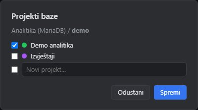

### Aktivni projekt

Na vrhu sidebara odaberi projekt. Tada:

- **Konekcije** pokazuju samo baze tog projekta,
- **Spremljeno** pokazuje samo njegove upite,
- **Povijest** pokazuje samo izvršavanja na njegovim bazama.

*Svi projekti* vraća sve. Brza promjena: **Ctrl+Shift+P**.

### Uređivanje projekta

Ikona zupčanika pored izbora projekta otvara popis projekata: naziv, opis, boja, *Arhiviran* (skriva ga iz izbora), popis baza (× miče bazu) i **aliasi** (poglavlje 15).

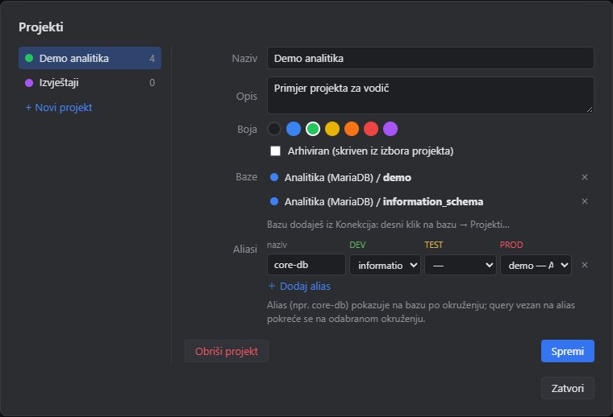

---

## 11. Spremljeni queryji

### Spremanje

1. U tabu napiši upit i pritisni **Ctrl+S**.
2. Upiši **Naslov**, po želji **Opis** (može biti i broj ticketa, npr. `DEMO-101`), **Mapu** (npr. `Izvještaji/Mjesečni`) i označi **Projekte**.
   QuCore sam predloži projekt kojem baza pripada.
3. **Spremi**. Tab dobije naslov upita.
4. Svaki sljedeći **Ctrl+S** u tom tabu sprema izmjene odmah, bez pitanja. **Ctrl+Shift+S** sprema kao novi upit.

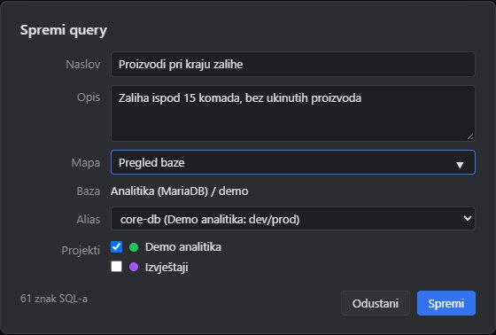

### Panel Spremljeno

Sidebar → tab **Spremljeno** (ikona oznake).

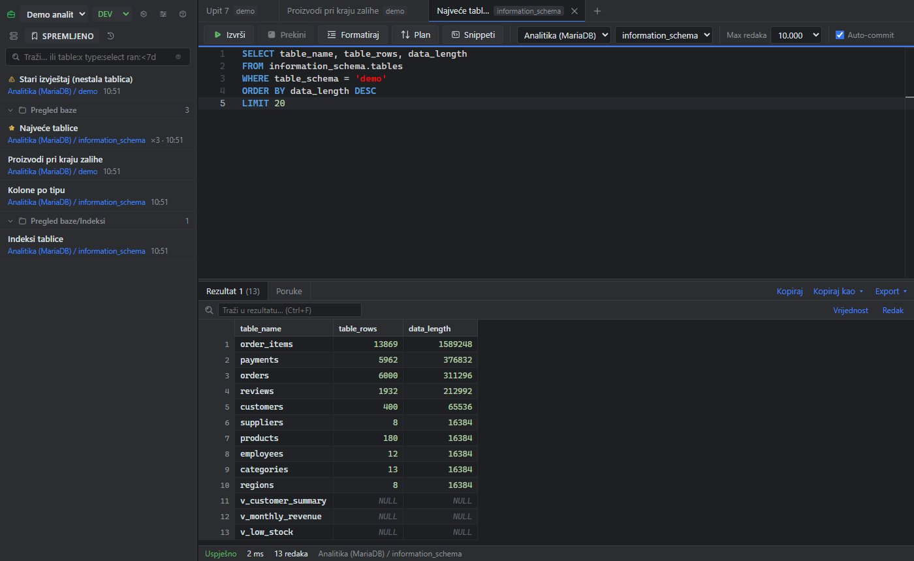

- **Nedavno pokretano** — do 5 upita pokrenutih u zadnja 2 tjedna.
- **Mape** se sklapaju klikom (QuCore pamti koje su zatvorene).
- ★ = prikvačen na vrh; **×N · vrijeme** = koliko je puta pokrenut i kada zadnji put.
- ⚠ = upit koristi tablicu koje više nema (vidi dolje).
- **Dvoklik** otvara upit (ako je već otvoren, samo prebaci na njegov tab).
- Desni klik: ubaci u editor, kopiraj SQL, prikvači, *Naslov, opis, mapa i projekti…*, *Verzije i izvršavanja…*, obriši.
- Prelazak mišem preko upita pokaže opis, tablice koje koristi, vrstu naredbe i SQL.

### Upozorenje: tablica više ne postoji

Kad u Exploreru otvoriš bazu, QuCore provjeri spremljene upite te baze. Ako upit koristi tablicu koje nema, dobije **⚠** s porukom koja tablica nedostaje i gdje je provjereno. Sve takve nađeš filtrom `is:broken`.

---

## 12. Pretraga i filteri

U polju na vrhu panela **Spremljeno** možeš pisati tekst (traži se u naslovu, opisu i SQL-u, bez obzira na č/ć/š/ž) i **filtere**. Gumb **?** pokaže popis; klik na primjer ga ubaci.

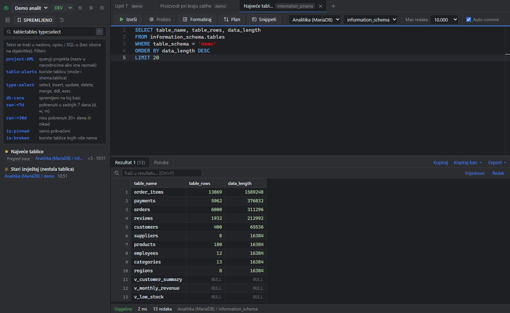

| Filter | Značenje | Primjer |
|---|---|---|
| `project:` | upiti projekta | `project:"Demo analitika"` |
| `table:` | koriste tablicu | `table:alerts`, `table:dbo.orders` |
| `type:` | vrsta naredbe | `type:select`, `type:delete` |
| `db:` | spremljeni na bazi | `db:core` |
| `ran:<7d` | pokrenuti u zadnjih 7 dana (`d`, `w`, `m`) | `ran:<2w` |
| `ran:>30d` | nisu pokrenuti 30+ dana (ili nikad) | `ran:>1m` |
| `is:pinned` | samo prikvačeni | |
| `is:broken` | koriste tablice kojih više nema | |

Primjer: `transakc table:alerts type:select ran:<7d` = upiti koji u tekstu imaju „transakc“, čitaju tablicu *alerts* i pokrenuti su ovaj tjedan. Krivo napisan filter javi se žutom porukom ispod polja.

---

## 13. Verzije i trend izvršavanja

Svako spremanje s **promijenjenim SQL-om** je nova verzija (promjena naslova ili projekata nije).

Desni klik na spremljeni upit → **Verzije i izvršavanja…**

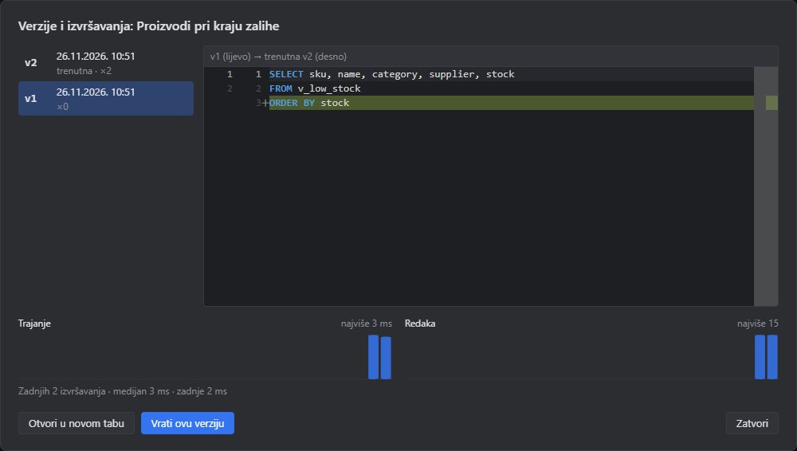

- Lijevo popis verzija (v1, v2…, datum, koliko je puta pokrenuta).
- Desno **usporedba**: odabrana verzija lijevo, trenutna desno; crveno = maknuto, zeleno = dodano.
- **Vrati ovu verziju** — sprema je kao novu (najnoviju) verziju; ako je upit otvoren u tabu, tekst se zamijeni (**Ctrl+Z** vraća).
- **Otvori u novom tabu** — samo pogledaj/pokreni staru verziju.
- Dolje **Trajanje** i **Redaka** zadnjih 30 izvršavanja (najnovije desno). Prelazak mišem preko stupca: datum, trajanje, retci, verzija. Sivi stupci su greške ili prekidi.

---

## 14. „Spremiti ga?“ — prijedlog spremanja

QuCore prepoznaje isti upit i s drugim vrijednostima. Kad isti upit pokreneš **5 puta u 7 dana**, iznad rezultata se pojavi:

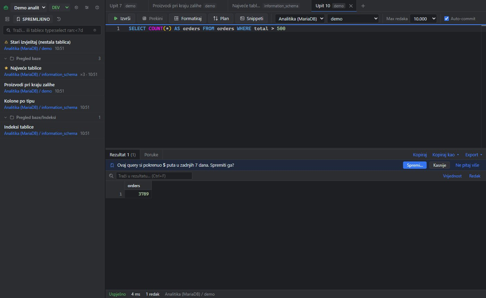

- **Spremi…** — otvara dijalog spremanja,
- **Kasnije** — ne pita više u ovom tabu,
- **Ne pitaj više** — za taj upit nikad.

---

## 15. Okruženja i aliasi baza

Isti upit često treba pokrenuti na **dev**, **test** i **prod** bazi. Umjesto tri kopije koristiš **alias**.

### Postavljanje

1. Konekcijama postavi **Okruženje** (dev / test / prod) u dijalogu konekcije.
2. Dodaj baze u projekt (poglavlje 10).
3. Zupčanik pored projekta → **Aliasi** → **+ Dodaj alias** → naziv (npr. `core-db`) i za svako okruženje odaberi bazu.
4. Pored izbora projekta pojavi se **DEV / TEST / PROD** — zadano okruženje u kojem se otvaraju upiti na aliasu.

### Upit na aliasu

Kod spremanja (Ctrl+S) odaberi **Alias** (QuCore ga predloži ako je baza taba dio aliasa). Takav tab u toolbaru pokazuje alias i **izbor okruženja**:

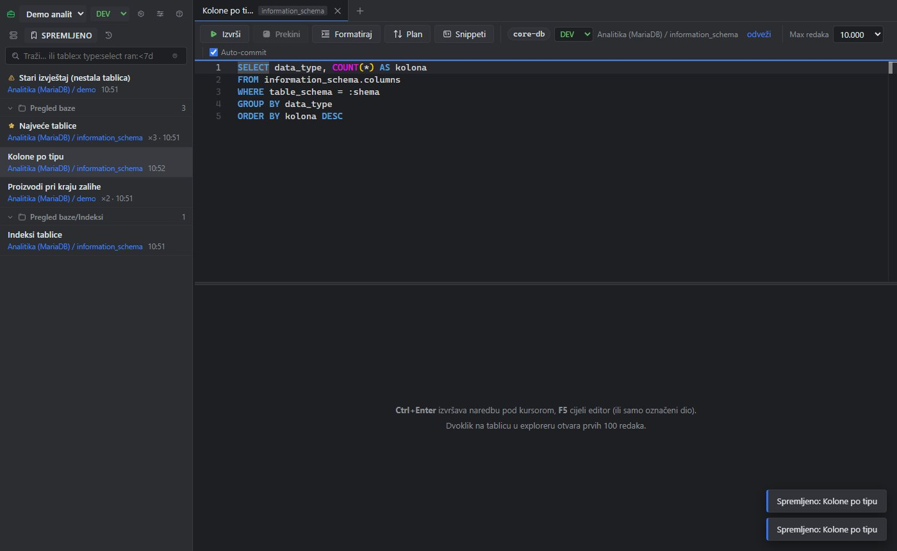

- Promjena okruženja u tabu prebaci tab na odgovarajuću bazu — isti upit možeš imati otvoren na testu i na produ.
- Promjena zadanog okruženja projekta **ne dira** otvorene tabove.
- **odveži** — tab ostaje na trenutnoj bazi, bez aliasa.

---

## 16. Varijable u upitima

Napiši `:ime` ili `${ime}` umjesto vrijednosti:

```sql
SELECT data_type, COUNT(*) AS kolona
FROM information_schema.columns
WHERE table_schema = :shema
GROUP BY data_type
```

Kod **F5** otvara se forma:

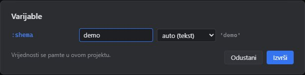

- Upiši vrijednost; **tip** je zadano *auto* (broj ako izgleda kao broj, inače tekst). Može i *tekst*, *broj*, *NULL* ili *SQL izraz* (npr. `CURRENT_DATE - 7`).
- Desno se vidi **točno što ide u SQL** (s ispravnim navodnicima). Neispravan broj ne da pokrenuti upit.
- Vrijednosti se **pamte po projektu**; izvršavanje otvoreno iz povijesti nudi vrijednosti koje su tada korištene.
- `:ime` unutar navodnika ili komentara, `::cast` (PostgreSQL), `:=` i `@varijable` (SQL Server) **nisu** varijable.

---

## 17. Snippeti

Snippet je spremljeni komad SQL-a (npr. `WHERE created_at >= CURRENT_DATE - INTERVAL 7 DAY`).

- Gumb **Snippeti** u toolbaru → klik na snippet ga ubaci na mjesto kursora.
- Označi tekst → **Snippeti** → **Spremi označeno kao snippet…** → naziv → *Vrijedi za* (projekt ili svi projekti).
- **Uredi snippete…** — izmjena, brisanje.

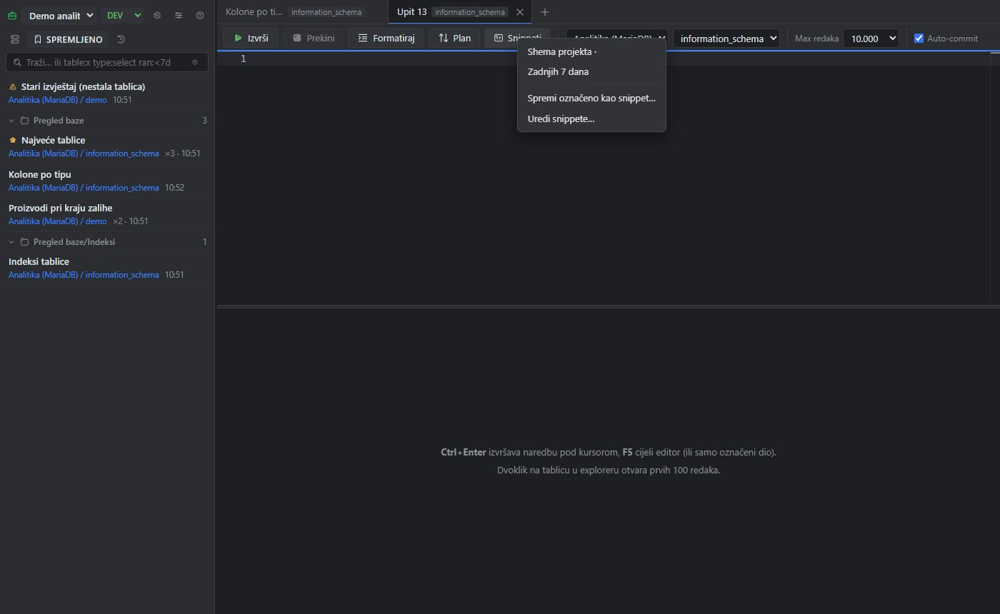

---

## 18. Brzo traženje (Ctrl+P)

- **Ctrl+P** — traži spremljene upite (aktivnog projekta) i projekte; dovoljna su prva slova. **Enter** otvara.
- **Ctrl+Shift+P** — samo promjena projekta.

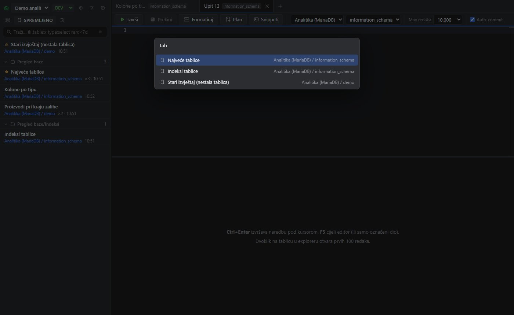

---

## 19. Zaštita: produkcija, upiti bez WHERE, kriva baza

Sve tri zaštite su zadano uključene; svaku možeš isključiti u [Postavkama](#21-postavke), gdje piše i što time riskiraš.

### Produkcija

Tab na konekciji označenoj kao **prod** ima crveni okvir i oznaku **PROD** (i u traci tabova). Prije `INSERT`, `UPDATE`, `DELETE`, `MERGE`, `CREATE/ALTER/DROP/TRUNCATE` ili `EXEC` pita za potvrdu. `SELECT` ide bez pitanja.

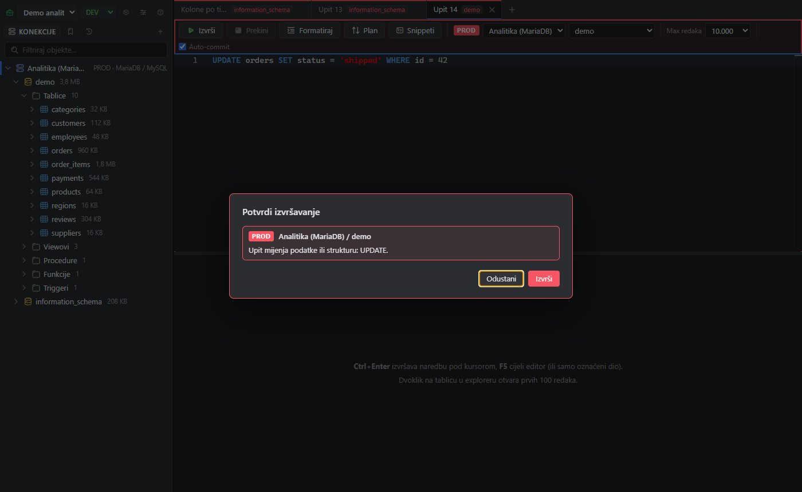

### UPDATE / DELETE bez WHERE, TRUNCATE

Na **bilo kojoj** konekciji, naredba koja mijenja **sve retke** traži dodatnu kvačicu **Razumijem da mijenja sve retke** — bez nje *Izvrši* ne radi. `WHERE` u podupitu se ne računa.

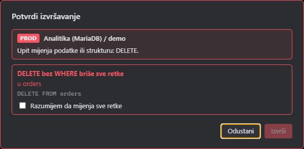

Fokus je uvijek na **Odustani**, pa slučajni Enter ništa ne pokreće.

### Kriva baza

Ako spremljeni upit pokrećeš na drugoj bazi nego što je spremljen, QuCore pita jesi li siguran (*Ne pitaj više u ovom tabu* isključuje pitanje za taj tab).

---

## 20. Upozorenja nakon izvršavanja

QuCore uspoređuje izvršavanje s prethodnima **istog upita na istoj bazi** i upozori žutom trakom kad je:

- **sporo** — više od 5× dulje od uobičajenog (i dulje od 1 sekunde),
- **prazno** — vratio je 0 redaka, a inače vraća retke.

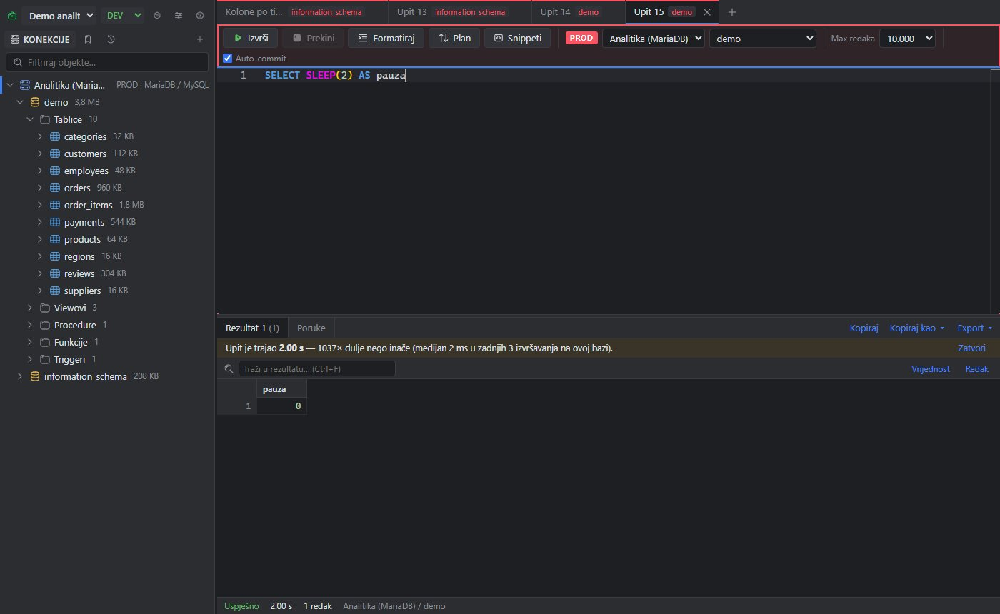

*Zatvori* skriva traku.

---

## 21. Postavke

Neka ponašanja QuCorea su kompromis između sigurnosti i brzine rada — npr. potvrda prije pisanja na produkciji ili Auto-commit. **Ti odlučuješ** kako ih želiš. Zadane vrijednosti odgovaraju onome kako je QuCore radio prije nego što su postavke postojale — dakle ništa se ne mijenja dok sam ne promijeniš. Jedna zadana vrijednost i sama nosi rizik i zato odmah pokazuje upozorenje: Auto-commit na produkciji je uključen.

1. Klikni ikonu **postavki** (klizači) pored izbora projekta, ili pritisni **Ctrl+,**.
2. Promijeni što želiš. Uz svaku postavku piše što radi, a kad odabereš rizičniju vrijednost pojavi se **žuto upozorenje** s objašnjenjem što time riskiraš. Promijenjene postavke imaju oznaku *promijenjeno*.
3. **Spremi**. *Vrati zadano* vraća sve postavke na zadane vrijednosti (i dalje treba Spremi).

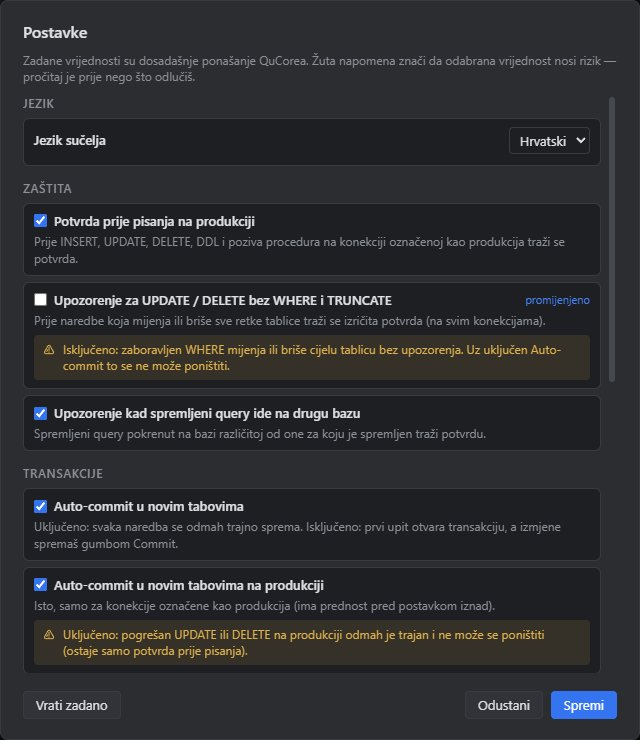

| Postavka | Zadano | Rizik ako je promijeniš |
|---|---|---|
| Potvrda prije pisanja na produkciji | uključeno | pisanje na produkciji ide odmah, bez pitanja |
| Upozorenje za UPDATE / DELETE bez WHERE i TRUNCATE | uključeno | zaboravljen WHERE mijenja ili briše cijelu tablicu bez upozorenja |
| Upozorenje kad spremljeni query ide na drugu bazu | uključeno | spremljeni query se tiho izvrši na krivoj bazi |
| Auto-commit u novim tabovima | uključeno | isključeno: i SELECT otvara transakciju koja drži zaključane retke dok ne klikneš Commit/Rollback |
| Auto-commit u novim tabovima na produkciji | uključeno | uključeno: pogrešan UPDATE na produkciji odmah je trajan; isključeno: pazi da zatvoriš transakciju |
| Istakni otvorenu transakciju nakon | 5 min | dulje vrijeme: kasnije primijetiš transakciju koja blokira druge |
| Ctrl+Enter izvršava | naredbu pod kursorom | *cijeli editor*: lako se izvrši i naredba koju nisi htio |
| Prazan redak dijeli naredbe | uključeno | isključeno: dvije naredbe bez `;` postaju jedna |
| Vrati otvorene tabove pri pokretanju | uključeno | uključeno: tekst tabova je nekriptiran u profilu; isključeno: nespremljeni tekst se gubi |
| Max redaka u novim tabovima | 10.000 | više redaka troši više memorije |
| Prijedlog „Spremiti ga?“ | uključeno | — |
| Upozorenja nakon izvršavanja | uključeno | isključeno: ne vidiš da je upit naglo sporiji ili prazan |

Korisno je znati:

- Postavke Auto-commit i Max redaka vrijede za **tabove koje otvoriš nakon promjene**; otvoreni tabovi zadržavaju svoje (u toolbaru ih možeš promijeniti i ručno).
- Ostale postavke vrijede odmah, u svim tabovima.
- Postavke su spremljene u profilu aplikacije (vidi [Gdje su moji podaci](#23-gdje-su-moji-podaci)).

### Jezik sučelja

QuCore radi na **engleskom** i **hrvatskom**. Jezik biraš na vrhu Postavki, u odjeljku *Jezik*.

1. Otvori Postavke (**Ctrl+,**).
2. U polju *Jezik sučelja* odaberi *English* ili *Hrvatski*.
3. Klikni **Spremi i ponovno pokreni**. QuCore se zatvara i odmah ponovno pokreće na novom jeziku.

Korisno je znati:

- Ako neki tab ima otvorenu transakciju, prije zatvaranja dobiješ uobičajeno pitanje (Commit / Rollback / Odustani). *Odustani* prekida i promjenu jezika: aplikacija ostaje otvorena, a novi jezik vrijedi od idućeg pokretanja.
- Otvoreni tabovi i njihov nespremljeni tekst se vraćaju ako je uključeno *Vrati otvorene tabove pri pokretanju*. Tabovi zadržavaju naslove koje su imali (npr. *Upit 3* ostaje *Upit 3* i na engleskom).
- Prvo pokretanje: postojeći profil ostaje na hrvatskom, a novi profil uzima jezik sustava (hrvatski ako je Windows na hrvatskom, inače engleski).
- Jezik mijenja i poruke iz baze koje QuCore sam piše (npr. *5 redaka obuhvaćeno*, greške pri spremanju). Poruke koje šalje sam server (npr. greška u SQL-u) ostaju na jeziku servera.
- *Vrati zadano* ne mijenja jezik.
- I ovaj vodič se prikazuje na jeziku sučelja (u aplikaciji, F1).

---

## 22. Prečaci

| Prečac | Radnja |
|---|---|
| **Ctrl+Enter** / **Ctrl+E** | izvrši naredbu pod kursorom (ili označeni dio) |
| **F5** / **Alt+X** | izvrši cijeli editor (ili označeni dio) |
| **Esc** | prekini upit |
| **Ctrl+T** / **Ctrl+W** | novi / zatvori tab |
| **Ctrl+Tab** / **Ctrl+Shift+Tab** | sljedeći / prethodni tab |
| **Ctrl+O** | otvori .sql datoteku (ili je povuci u prozor) |
| **Ctrl+S** | spremi upit (ili spremi izmjene spremljenog); u tabu datoteke — spremi u datoteku |
| **Ctrl+Shift+S** | spremi kao novi upit |
| **Ctrl+P** | spremljeni upiti i projekti |
| **Ctrl+Shift+P** | promjena projekta |
| **Ctrl+Space** | prijedlozi (tablice, kolone) |
| **F1** | vodič |
| **Shift+Alt+F** | formatiraj SQL |
| **Ctrl+Shift+E** | plan izvršavanja naredbe pod kursorom |
| **Ctrl+F** / **Ctrl+H** (u editoru) | traži / traži i zamijeni |
| **F3** / **Shift+F3** | sljedeći / prethodni pogodak |
| **Ctrl+D** | označi i sljedeće isto pojavljivanje (više kursora) |
| **Ctrl+,** | postavke |
| **Ctrl+C** (u tablici rezultata) | kopiraj ćeliju |
| **Ctrl+A** (u tablici rezultata) | kopiraj sve retke s nazivima stupaca |
| **Ctrl+F** (u tablici rezultata) | traži u rezultatu (filter) |
| **Shift+Enter** (u tablici rezultata) | puna vrijednost ćelije (panel desno) |
| **F2** / dvoklik | uredi ćeliju (uređivanje podataka) |
| Srednji klik na tab | zatvori tab |
| Dvoklik na tablicu | prvih 100 redaka |
| Dvoklik na kolonu | ubaci naziv u editor |

---

## 23. Gdje su moji podaci

Sve je u mapi `%APPDATA%\QuCore`. Ako si koristio verziju stariju od 0.17, aplikacija pri prvom pokretanju sama preimenuje staru mapu `%APPDATA%\SQL Studio` u `QuCore`, a konekcije, lozinke i povijest ostaju.

| Datoteka | Sadržaj |
|---|---|
| `connections.json` | konekcije; lozinke kriptirane (Windows DPAPI) |
| `qucore.db` | projekti, spremljeni upiti, verzije, povijest, snippeti, vrijednosti varijabli (SQLite) |
| `Local Storage` | postavke, otvoreni tabovi i njihov nespremljeni tekst (ako je uključeno vraćanje tabova), aktivni projekt (podaci preglednika unutar aplikacije) |
| `file-grants.json` | popis .sql datoteka koje si otvorio ili spremio kroz QuCore; samo u njih *Spremi u datoteku* smije pisati bez dijaloga |
| `history.jsonl.imported` | stara povijest iz verzija do 0.9 (sigurnosna kopija, može se obrisati) |

**Backup:** zatvori QuCore i kopiraj cijelu mapu. Tekst upita u povijesti i u otvorenim tabovima nije kriptiran.

Zašto `file-grants.json`: QuCore čita i sprema samo datoteke koje si sam odabrao (dijalog *Otvori*, *Spremi kao* ili povlačenje u prozor). Tab s datotekom otvorenom u verziji starijoj od 0.19 zato prvi put spremi kroz *Spremi u datoteku kao…*; nakon toga Ctrl+S radi kao i prije.

---

## 24. Česta pitanja

**Upit se ne pokreće, nego se otvori prozor.** To je forma za varijable (poglavlje 16) ili potvrda zaštite (poglavlje 19).

**Ne vidim neku bazu u Exploreru.** Provjeri izbor projekta na vrhu — aktivni projekt skriva baze koje mu ne pripadaju. Odaberi *Svi projekti*.

**Windows prijava javlja da nema ODBC drivera.** Instaliraj *ODBC Driver 18 for SQL Server* s Microsoftove stranice i ponovno pokreni QuCore.

**Upit vraća samo dio redaka.** Dosegnut je *Max redaka*; koristi *Učitaj još* ili povećaj *Max redaka* u toolbaru.

**Spremljeni upit ima ⚠.** Tablica koju koristi nije pronađena kad je baza zadnji put otvorena u Exploreru. Pogledaj tooltip (koja tablica, gdje) i ispravi upit — spremanje briše staro upozorenje.

**Kako vratiti stariju verziju upita?** Desni klik → *Verzije i izvršavanja…* → odaberi verziju → *Vrati ovu verziju*.
